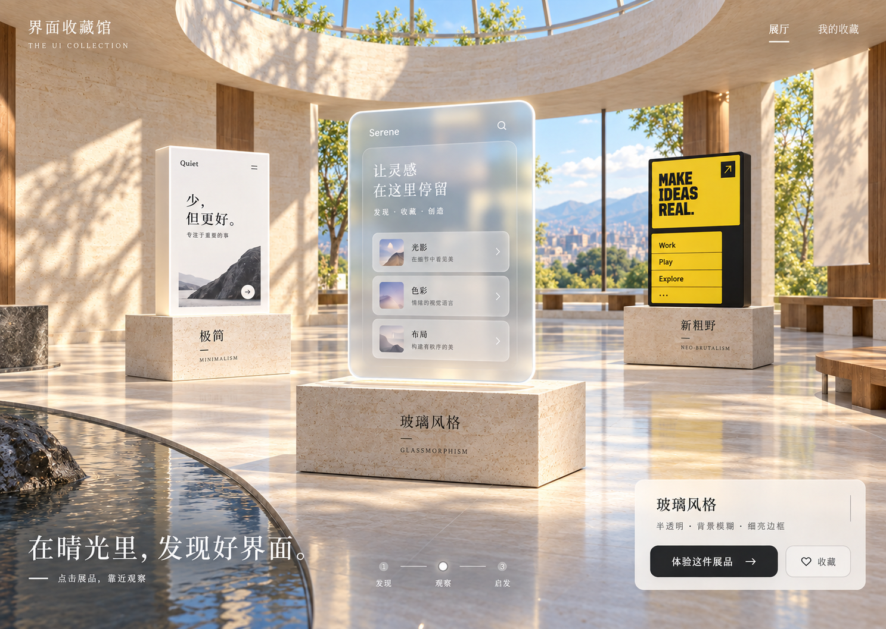
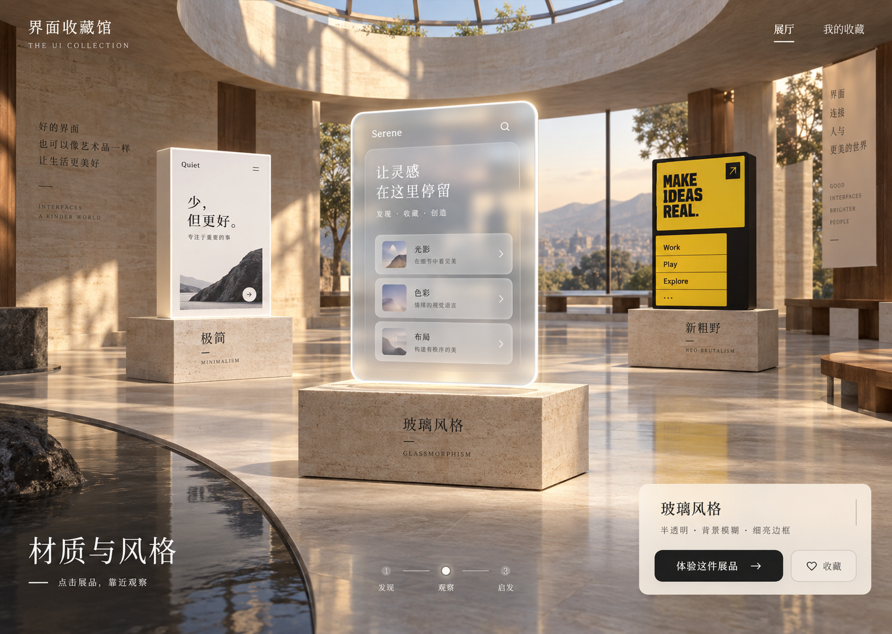
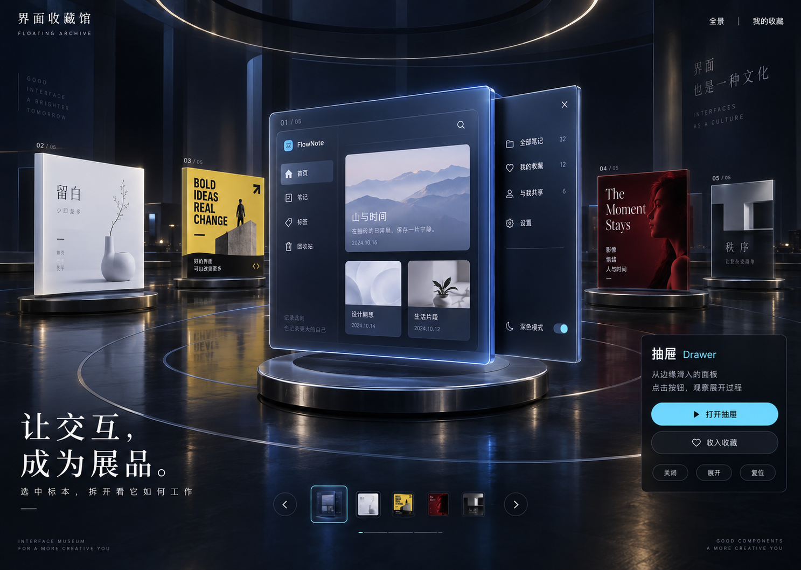
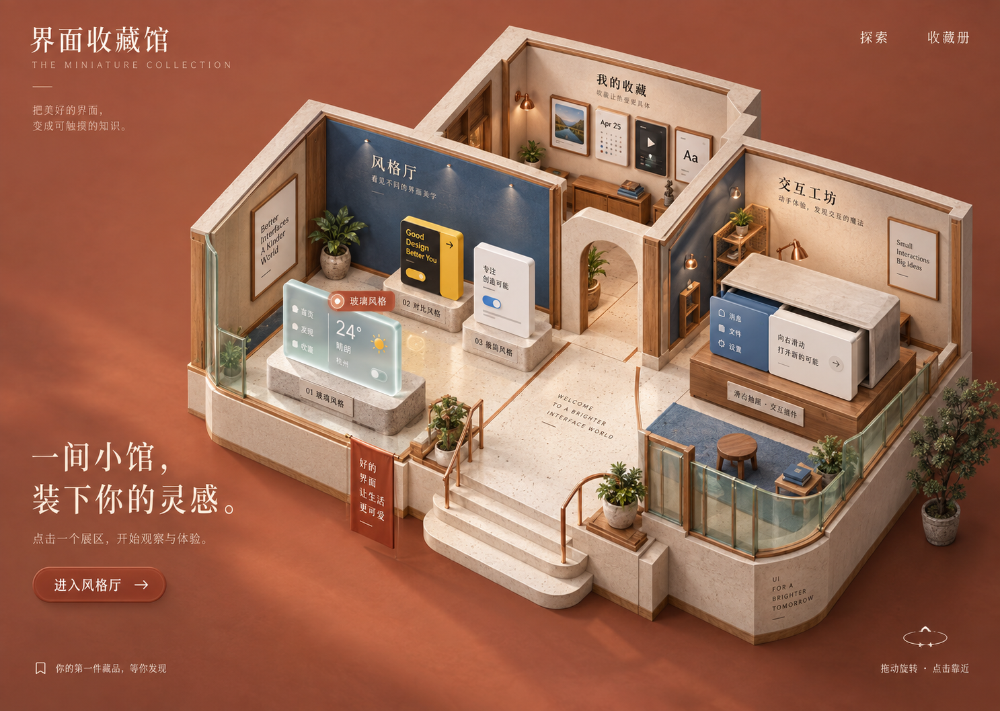

# 界面收藏馆 · 3D 图鉴概念设计

> 当前为历史探索。2026-09-17 用户明确改用 [2D 方块图鉴](../../learning/ui-atlas-2d/README.md)，不再继续一比一复刻或建设自由漫游收藏馆。下文保留当时设计过程。

日期：2026-09-17。状态：最初的方向 1 原稿仍为正式视觉参考，无需进一步提亮。已制作 [WASD 早期原型](../../experiments/002-sunlit-museum/README.md)，但用户明确指出与原稿差距太大，视觉未通过验收。见[可行性与下一步说明](rendering-feasibility.md)。

## 设计缘起

用户认可图鉴的学习形式，但不喜欢现有 UI 风格，希望探索“3D 场景中的收藏馆”。本次延续入门教学目标，重新设计空间表达和参观体验。随后用户选择方向 1，明确喜欢阳光灿烂、明亮带来的愉快感；具体材料参数和镜头实现尚未确定。

## 已选择的方向：晴光收藏馆

**最终视觉参考：[方向 1 原稿](./images/01-quiet-gallery.png)。** 用户看过提亮后的 v2 后确认：“不需要更亮，我认为原来的那一版就完全可以，看起来更自然。”后续实现应保留原稿的亮度、暖意、明暗层次和自然感；下文参数描述均以原稿为准，不继续强化亮度或补光。v2 仅保留为未采用的探索记录。

用户反馈：“我更喜欢1，我看中了阳光灿烂、明亮等感觉，就像晴天真的会让人的兴趣好一样。”

**设计目标：让人感到像走进一个阳光充足的晴天空间，心情舒展，愿意停留、观察和探索。** 这是用户的感受目标，不是已经验证的心理学结论。

“晴光收藏馆”为本轮助手提出的工作名称，尚未确认正式命名。

### 把感受转成视觉语言

| 用户感受 | 对应设计选择 | 实施时观察什么 |
| --- | --- | --- |
| 阳光灿烂 | 天窗、侧窗、可见日照光斑与细碎树影 | 是否能感知阳光的方向和来源 |
| 明亮 | 暖白石材与充分的环境补光，阴影仍保留细节 | 是否既通透，又能看清材质与文字 |
| 舒展 | 开阔视野、蓝天、绿叶，少量展品之间留出空间 | 是否愿意停留，是否容易找到下一件展品 |
| 温暖愉快 | 保留日光的暖意，搭配自然材质与少量木色 | 是否自然清新，是否偏黄或压抑 |

后续沟通可用词：**晴天感、自然采光、通透、暖白、柔和树影、空气感、亲自然设计（Biophilic Design）**。其中“亲自然设计”是对植物、自然光和自然材料取向的辅助描述，不能单独概括整个馆。

### 细化稿 v2（未采用，仅作探索记录）

生成方式：内置 Image Gen；实际附加方向 1 原图作为编辑参考。保留弧形展厅、天窗、机位、展台与三个 UI 标本，重点调整光照、环境与气氛。

提示要点：增加晴朗自然光和反射补光，提亮顶部与前景阴影，保留暖白石材纹理和柔和日照，加入可见蓝天、绿叶与树影；控制曝光、眩光与偏黄，保持展品区分和正文可读。该图是方向 1 的细化版本，不是重新提出第四个方向。

设计检查：细化图呈现了更清晰的蓝天、绿叶与树影，空间阴影有所提亮。用户反馈原稿更自然，因此不采用这一版。实际文字对比度、材质、运行性能与动态镜头仍需在前端实现中验证。图中 AI 生成的小字并非最终文案，例如体验按钮需在代码中校对为“体验这件展品”。

## 核心创意

把 UI 知识做成可以观察、操作、收藏的展品。用户进入收藏馆，点击一件展品，镜头自动靠近；体验材质或交互后，带走术语和一段能直接发给 AI 的描述。

馆的外观负责营造氛围，展品自身准确展示不同 UI 风格。收藏馆的暖色灯光、透明面板或深色背景不能把所有展品染成同一种风格。

## 三个方向

编号依据本次对话中图片的显示顺序。下面均为内置 Image Gen 生成的独立概念稿，不是运行截图。

| 编号 | 方向 | 空间与参观方式 | 要进一步验证的取舍 |
| --- | --- | --- | --- |
| 1 | 静谧美术馆 | 暖白石材、天窗、独立展台；点击展台自动靠近 | 空间氛围突出，真实光照和材质需要控制实现成本 |
| 2 | 悬浮档案馆 | 深色环形陈列、发光标本；轮转选取，近距离拆解状态 | 聚焦展品，但要抑制反光、发光和透视对阅读的干扰 |
| 3 | 微缩收藏屋 | 俯视开顶的小馆；先选房间，再进入展品视角 | 展区关系直观，小比例文字必须在靠近后转换为清晰阅读内容 |

### 1 · 静谧美术馆

### 2 · 悬浮档案馆

### 3 · 微缩收藏屋

## 参观过程

具体的镜头、近景教学、收藏和返回行为见[交互方案讨论稿](./interaction-design.md)。目前建议点选式参观，自由漫游偏好待确认。

1. **进入全景**：看见展区和少量有代表性的展品，主入口明确。
2. **选中展品**：展品轮廓轻微高亮，显示中英文名称；触屏以点击为入口，不依赖悬停。
3. **靠近观察**：镜头沿预设路径移动到合适角度，给出稳定的返回全景入口。
4. **现场体验**：出现可操作的真实 UI 示例；教学文字放在朝向屏幕的清晰面板中。
5. **收藏发现**：记录术语、选择的参数和个人备注，收藏结果在收藏册中可查。
6. **组合表达**：挑选收藏中的风格、布局和组件，生成一段设计描述。

默认采用点击导航和预设镜头。自由旋转可以是补充，WASD 行走不作为学习前提。减少动态效果模式下，镜头切换应缩短或直接切换。

## 展品怎样演示自己

| 展品 | 可见形态 | 体验动作 | 应学到的内容 |
| --- | --- | --- | --- |
| 玻璃风格 | 背后带彩色色块的半透明 UI 标本 | 调整背景模糊与不透明度 | 磨砂、透明和正文清晰度是不同问题 |
| 新粗野风格 | 粗描边与硬偏移阴影的 UI 标本 | 按住按钮观察下压反馈 | 描边、阴影和强色块构成的表达 |
| 抽屉 | 一块包含可展开侧面板的界面 | 打开、关闭、复位 | 边缘进入、上下文保留、关闭方式 |
| 模态弹窗 | 可以阻止背景操作的对话框示例 | 打开后尝试背景与键盘操作 | 模态是一种交互限制，不是固定位置 |
| Toast | 操作之后出现的短暂提示 | 模拟保存 | 反馈出现后消失，主流程仍能继续 |
| 便当盒布局 | 大小不同、边缘对齐的内容模块 | 切换桌面与窄屏结构 | 布局与视觉风格是可以组合的维度 |

实物柜子的抽屉、建筑模型或玻璃雕塑只能辅助理解；实际展品仍需要展示真正的 UI 行为，避免用隐喻替代知识本身。

## 收藏册的价值

每件收藏包含：名称与分类、预览、本人选择的参数、个人备注、可以复制的需求描述。先采用本地收藏作为实现提案，不默认增加账号、云同步或社交功能。

例子：

> 我想做一个个人灵感页。使用玻璃风格的卡片，背景模糊但文字清晰；桌面采用便当盒布局。点击编辑后打开右侧抽屉，背景加遮罩，支持 Esc 和关闭按钮。保存后出现短暂成功提示。

“收藏”意味着随时能找到并使用，不强制设置考试、徽章或解锁门槛。

## 首个可运行版本的建议范围

- 一个小型展厅、三个视觉风格标本，以及抽屉、弹窗两种组件的近景体验。
- 全景与展品近景切换、清晰的返回操作。
- 近景中的真实交互、解释和可复制描述。
- 一个本地收藏册，验证收藏后再进入仍能找回的行为。
- 手机端用固定机位或单展品模式；保留文字浏览入口与减少动态效果选项。

视觉方向已确定为方向 1 原稿；以上仍是实施范围提案，具体交互见讨论稿。当前没有承诺概念图中的全部建筑细节、光照和反射会逐像素进入实时版本。

## 实现时需要守住的边界

- 3D 负责空间、镜头与展台；正文、表单、弹窗等使用清晰可访问的界面层。
- 场景拖动和展品内部操作应有明确的控制权切换，拖滑块时不能同时旋转镜头。
- 文字不能长时间处于强透视角度；进入教学状态后应以阅读舒适为准。
- 展品的视觉对比应能在中性观察环境下进行，避免馆内光色造成误判。
- 需要实际验证渲染性能、资源加载、键盘操作、触屏命中、晕动感与恢复路径。
- 概念图里 AI 生成的日期、按钮文字、标签和示例 UI 不是正式内容规范，实施时应使用经过校对的教材内容。

## 概念图生成记录

方式：内置 Image Gen，三个独立生成调用，无外部参考图；用户要求新方向，因此没有把不喜欢的旧页面作为视觉目标。

共同提示约束：1440×1024 桌面应用构图、中文入门教学、3D 场景占主要视野、展品必须是 UI 标本、少量清晰导航、一个主要体验动作；避免普通卡片仪表盘、密集信息、设备边框与多方案拼图。

方向提示要点：

- 静谧美术馆：暖白洞石、弧形墙、天窗、柔和日光、玻璃/极简/新粗野三个展台，近景配简短阅读面板。
- 悬浮档案馆：午夜蓝、环形标本陈列、克制青紫边缘光、选中抽屉标本的侧面板展开、底部切换入口。
- 微缩收藏屋：轴测俯视、开顶建筑模型、桦木与奶油石膏、陶土色背景、风格厅/交互工坊/收藏墙三个相连区域。

提示中的目标尺寸是构图意图，图片实际尺寸以文件为准。当前只有概念图检查，没有真实 3D 运行、性能或学习效果验证。
