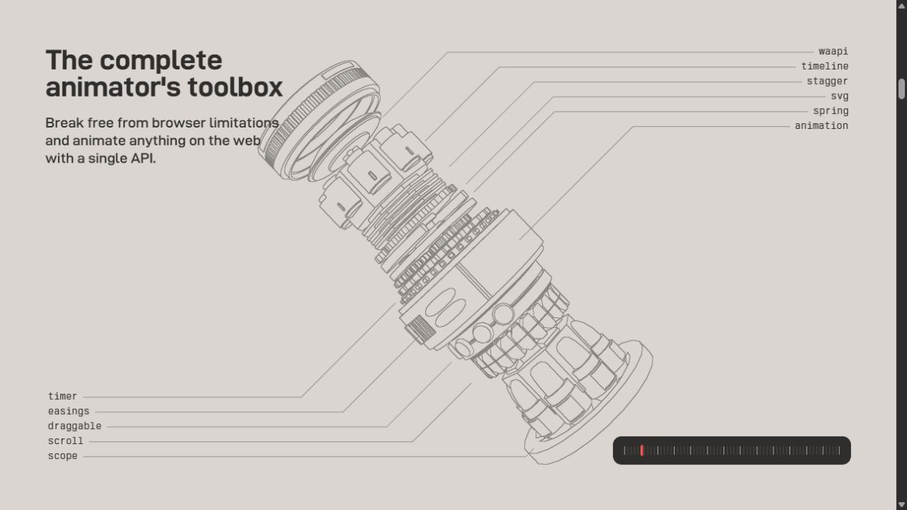
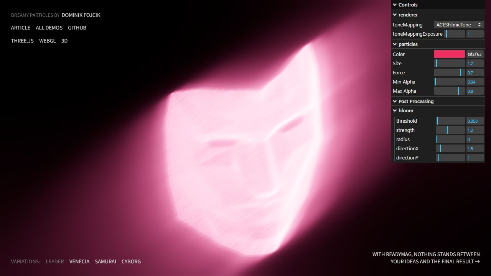
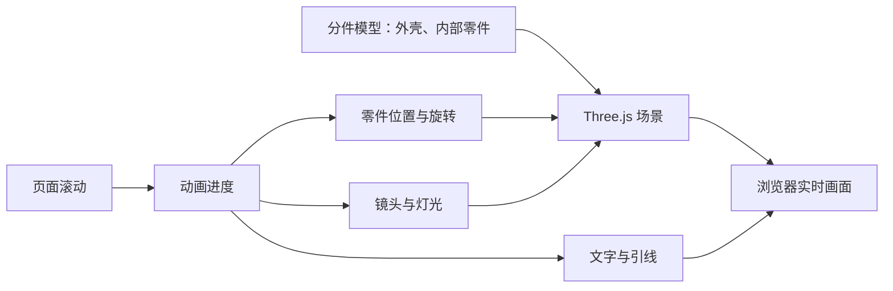

# 3D 拆解与粒子交互网页：案例、原理与设计判断

调研日期：2026-09-17。用户提到曾在 X 看到很酷的物体拆解和粒子交互网页，但已找不到原帖。本轮寻找可体验、有一手证据的代表作品，不声称已找到原帖，也不声称已核实其传播热度。此次只研究和记录，不向图鉴添加粗略复刻，不恢复 3D 收藏馆项目。

## 先看真实案例

| 作品 | 操作与观察 | 已核实到什么程度 |
| --- | --- | --- |
| [Anime.js 官网](https://animejs.com/) | 向下缓慢滚动，看机械装置转向、分层展开、出现模块引线和功能名称 | 本轮实际滚动、截图；DOM 标记 Three.js r172；读取已加载脚本确认分件 GLB 与滚动同步时间轴 |
| [Dreamy Particles](https://tympanus.net/Tutorials/DreamyParticles/) · Dominik Fojcik | 移动指针，观察发光面具与粒子运动；页面也提供不同面具变体 | 本轮打开和操作，画面正常呈现并响应指针；技术链路来自[作者教程](https://tympanus.net/codrops/2024/12/19/crafting-a-dreamy-particle-effect-with-three-js-and-gpgpu/)与[源码](https://github.com/DGFX/codrops-dreamy-particles) |
| [TSL Morphing Particles](https://tsl-morphing-particles.vercel.app/) | 粒子在不同物体轮廓间变换，认识 Particle Morphing | 已读取[作者实现说明](https://github.com/chrismaldona2/tsl-morphing-particles)，本轮未实际操作其浏览器页面 |

Anime.js 拆解截图，来源为原站本轮实际渲染：

Dreamy Particles 原站截图；发光强度是该次页面显示状态，不是我们重做的设计：

另检索了 [ThreeUI](https://threeui.com/browse) 并在目录搜索 `explod`，得到多个产品拆解方向。实际检查的 [NOEMA N1](https://threeui.com/landing-pages/noema-n1-landing-page) 是机器人发布页，公开说明包含 exploded anatomy；其页面明确只给 Pro 视频预览，不向公开访客挂载实时渲染器。本轮未访问会员源码，所以不能把这段预览当作已验证的实时 3D 实现。其[公开仓库](https://github.com/MengTo/threeui)也明确 Community 与 Pro 的边界。

## 1. 物体“拆开”通常叫 Exploded View

可以用的关键词：**Exploded view（爆炸图 / 分解视图）**、**Scroll-driven 3D（滚动驱动 3D）**、**Product scrollytelling（产品滚动叙事）**。这里“爆炸”指零件分散展开，不一定有爆炸特效或物理碰撞。

一个耳机示例的设计过程可以是：

1. 完整外观，先让人认出产品。
2. 外壳移开，露出内部层次。
3. 振膜、线圈、磁铁沿安排好的方向分离。
4. 镜头停在能看清关系的位置，文字解释对应零件。
5. 反向滚动时按同一条时间轴复原。

这是一段建议的分镜，不是对某个已检查耳机网站的事实陈述。

实现时，动画系统通常只是把每个部件从组装位置移到拆解位置。用简化式表示：

`部件位置 = 组装位置 + 拆解方向 × 展开距离 × 当前进度`

真实作品会给各零件不同的延迟、缓动和停留段，还会一起改变旋转、镜头、灯光及文字。滚动像在拖一条播放进度条，而不必每次滚一下就启动一个独立动画。[GSAP ScrollTrigger](https://gsap.com/docs/v3/Plugins/ScrollTrigger/)和 [Anime.js onScroll](https://animejs.com/documentation/events/onscroll/)都提供滚动同步机制，但不能因此断言某个网站用了 GSAP。

### Anime.js 的直接证据

- 在页面的 `canvas#renderer` 上读取到 `data-engine="three.js r172"`。
- 页面加载的 [home.js](https://animejs.com/assets/js/home.js?v=1787698626) 包含 GLTFLoader，并在 `loadGeometries()` 中加载 `module-animate-01.glb`、`module-engine-01.glb`、`module-scroll-01.glb` 等 22 个模型路径。
- 同一脚本存在命名时间轴阶段 `TOOLBOX`、`MODULES`，以及绑定 `document.body` 的滚动同步；模块引线和标注与场景动画一同编排。
- 因此可以确认此案例包含实时 Three.js、分件模型和滚动动画。没有核实这些模型由 Blender、Cinema 4D 或其他软件制作，不把常见流程当成作者实际流程。
- 脚本 URL 与 Three.js 版本是此次检查结果，网站更新后可能改变。

### 要不要建模，取决于你想表现什么

| 路线 | 网页里真正运行的内容 | 准备工作与边界 |
| --- | --- | --- |
| 实时 3D | 三维零件、材质、灯光和镜头 | 需要可分件的模型，或用代码生成几何体；可以设计额外观察角度与交互 |
| 预渲染序列帧 | 根据滚动进度绘制指定图片帧 | 准备好整段动画画面；只能显示事先渲染的角度和状态 |
| 分层图片 / CSS 3D | 独立图片或 DOM 图层在空间展开 | 需要分层素材；厚度与背面细节受素材和构造限制 |

序列帧路线有 [GSAP 官方 Canvas 示例](https://gsap.com/docs/v3/HelperFunctions/helpers/imageSequenceScrub/)。分层 CSS 路线可看作者自己的 [Exploded View Scroll 说明](https://gsapvault.com/effects/exploded-view-scroll)：层可以是 PNG、SVG 或普通元素，使用 preserve-3d 和滚动进度。此处只依据公开说明，不声称已审计其付费源码。

对本课题的实际判断：要做精细产品拆解，先确认**模型是不是已经分好零件**。只拿到一张产品图，或一个融合成整体的表面模型，不能直接保证内部零件存在。我们可以用授权现成模型或程序化零件，不要求用户亲自从零学建模；但素材准备这一步不能靠换框架跳过。

## 2. 3D 粒子不只是“更多的发光点”

先分清两个效果：

- **Particle morphing（粒子形态变换）**：每颗点有形状 A 和形状 B 中的位置，按进度从 A 走到 B。
- **Interactive particle simulation（交互粒子模拟）**：每颗点有速度，受到推力、回归力、阻尼等影响，再计算下一帧。

它们可以组合。粒子从面具散开，最后变成一只鸟，既可以有预设目的地，也可以在路上受到鼠标扰动。[形态变换作者说明](https://github.com/chrismaldona2/tsl-morphing-particles)、[交互面具作者教程](https://tympanus.net/codrops/2024/12/19/crafting-a-dreamy-particle-effect-with-three-js-and-gpgpu/)

Dreamy Particles 的链路是：从模型表面取点，把位置和速度存成数据纹理，在 GPU 上更新运动，再绘制点并叠加 Bloom。鼠标本来只有二维坐标，通过 Raycaster 找出三维模型上的交点，用它影响附近粒子。详细术语、变形与模拟的差别见[粒子专项研究](./particle-web-research.md)。

球、环、波浪一类形状可以由数学公式生成；具体面具、动物或产品轮廓可以从模型采样。于是“粒子效果是否需要模型”的答案也取决于目标形态。

## 3. 作为 UI 设计课题，真正值得观察什么

以下是本项目的设计分析，不是对所有用户通用的审美结论：

- **内容与形式是否有关联**：Anime.js 把“动画引擎”做成机械装置，每个零件解释一项能力；运动在讲内容。
- **轮廓是否明确**：粒子先组成能辨认的形状，扰动才有可比较的前后状态。
- **变化是否有节奏**：完整、变化、停留、恢复各有作用；不停地转、散、闪，未必能让人看清。
- **光影是否服务体积**：高光让边缘和材质可辨，景深与发光要保留主体的形状，不是参数越大越好。
- **交互是否可理解**：用户能看出滚动或指针造成了什么，并能停下来观察。
- **整页是否协调**：模型机位、留白、标题和标注共同构图；只把一个酷炫 Canvas 塞到普通页面里，未必得到同样的完成度。

我们下一次若做实验，先选定一种题材和一小段分镜，确认关键静态画面有吸引力，再实现动态过程。不要以“运行成功、粒子数量很多”替代设计验收。这个流程建议吸收了用户对前次配色栏目和 3D 收藏馆的反馈，尚未验证其稳定性。

## 能直接用于交流的描述

> 做一个滚动驱动的 3D 产品分解展示（scroll-driven exploded view）。先完整展示产品，随后外壳与内部模块分段展开；关键部件停留并出现简短标注，反向滚动可复原。先确认分件模型、机位、光照和展开后的构图，再实现完整时间轴。

> 做一个可被鼠标扰动的 3D 粒子雕塑（interactive particle sculpture）。粒子初始组成清楚的主体轮廓，鼠标只扰动局部，移开后柔和回归；保留轮廓、空间层次和阅读留白。需要形态转换时，明确各目标形状与停留顺序。

这些是研究后的描述范例，未声称已实现。当前图鉴保持原状，不恢复已删除的配色栏目。

## 验证与检索边界

- agent-reach 检查显示 X 没有可用的已连接后端；Exa 真实查询因本地配置访问失败，后续通过可用网页检索与原站阅读研究。公开索引中虽出现相关 X 转述线索，但不足以确认用户原帖或热度。
- 在真实浏览器操作了 Anime.js 与 Dreamy Particles；保存了截图，未做跨设备性能基准或移动端兼容性验收。
- 没有购买模板、登录会员或绕过 ThreeUI 的源码权限。其公开宣传可用于定位方向，不能替代源码证据。
- 代码实现与 API 事实以文中官方文档、作者文章、源码和本次运行时检查为依据；设计建议已单独标明。
