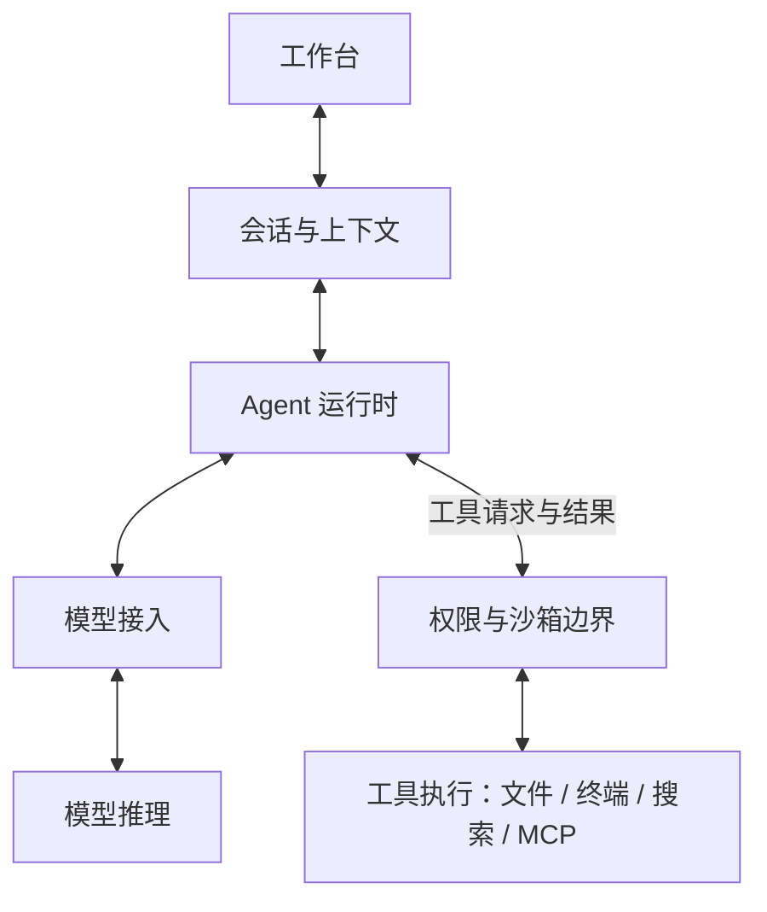

# AI Agent 架构拆解页：架构与分镜草案

日期：2026-09-18。状态：本文的通用架构已被用户明确替换，不再作为实现依据；保留为原始分镜记录。当前指定 DeepSeek Harness 最新开发版，见 [源码架构与修订方案](./deepseek-harness-architecture.md)。尚未实现页面或验证截图。

## 用户指定的故事

同一个类似 Codex 桌面版的操作面板贯穿始终：发送问题，面板缓慢侧转至边缘接近一条线，信息向下延伸并展开架构层；每层可悬停了解作用；抵达底部模型后，淡蓝色二进制粒子向上返回，面板转回原状并流式显示答案。保留阅读停顿。先验证首屏和拆解构图，再扩展段落；每个响应式断点用同一进度对照截图。用户提供本地 Blender 可用条件，并未要求必须建模。

## 建议架构：通用 Coding Agent 的逻辑结构

这是为教学设计的参考架构，不声称是 Codex 桌面版实际内部架构，也不代表各层各自部署为服务。

| 主层 | 对外标签 | 悬停说明 |
| --- | --- | --- |
| 1 | 工作台 / Workspace | 接收问题，展示执行状态、文件变化和答案。 |
| 2 | 会话与上下文 / Session & Context | 组织对话、项目规则与已取得的相关资料，形成当前请求上下文。 |
| 3 | Agent 运行时 / Agent Runtime | 驱动模型调用、处理工具请求、接收执行结果，管理本轮任务状态与停止条件。 |
| 4 | 模型接入 / Model Adapter | 把请求转换成模型接口支持的格式，并接收流式事件；独立网关是可选部署方式。 |
| 5 | 模型推理 / Model Inference | 根据输入生成文本或工具调用请求。模型用抽象核心表达，不假装展示真实神经网络内部。 |

运行时旁边放置工具执行侧支，包含文件读取、终端、搜索或 MCP；执行前通过权限与沙箱边界。实际工具可能本地或远程运行，图中位置表达职责，不表达物理位置。

真实 Agent 可以在模型产生工具请求后执行工具，再带着结果调用模型，直到得到最终输出。官方运行循环依据：[OpenAI Agents SDK — Running agents](https://openai.github.io/openai-agents-js/guides/running-agents/#the-agent-loop)。工具职责依据：[Tools](https://openai.github.io/openai-agents-js/guides/tools/)。五层划分是本设计的教学抽象，不是官方规定。

演示问题建议：“这个项目的入口在哪里？请解释一次请求的处理流程。”这使读取文件有明确用途。完整故事可加入一次简短的模型→运行时→文件工具→运行时→模型往返；首轮构图验证只展示主结构，不把尚未绘制的工具循环误当成已经实现。

## 分镜与进度约定

| 归一化滚动进度 | 主动作 | 可阅读状态 |
| --- | --- | --- |
| 0–12% | 正面工作台，问题出现并发送 | 保持面板正面，真实排版可阅读 |
| 12–25% | 面板绕水平轴缓慢侧转，成为水平细边；相机拉远，主体移到上方 | 接近侧面时隐藏不可读 UI 文本，保留轮廓；避免 z-fighting |
| 25–48% | 请求脉冲向下，逐层展开薄板，模型最后出现 | 每层出现后短距离内保持位姿，标签保持正向 |
| 48–62% | 完整架构定格，展示工具侧支与一次短循环的预留位置 | 各层支持 hover、键盘 focus、触屏点击说明 |
| 62–80% | 模型发出淡蓝色 0/1 粒子，沿返回路径向上 | 各层轻微点亮，说明仍可查看 |
| 80–92% | 粒子回到顶部，层板退场，面板转回正面 | 连续保持同一面板的位置与身份 |
| 92–100% | 面板上的答案逐段揭示 | 结束处保留完整答案 |

0/1 粒子是数据流的视觉隐喻，不代表真实网络包内容或推理轨迹。页面为预设内容演示，首版不需要连接模型服务。为了满足停下来阅读与反向滚动，流式回显采用由进度决定的文本截取；它模拟流式观感，不能声称是实时模型 token 流。

## 构图与技术建议

延续前次讨论，优先考虑页面中的独立展示窗口：窗口内滚动驱动时间轴，外部正常滚动，底部自定义刻度可拖动；支持全屏查看。此窗口方式尚待本次架构确认时一并确认。

首屏主要面积留给可读的 Agent 面板；架构完全展开时，上方保留面板细边，中间四层有足够垂直间距，底部模型为视觉终点。主路径居中，层名称在一侧，悬停详情放固定说明区域，避免说明卡遮挡主体。手机上点击层名称打开说明，不能只依赖 hover。

建议采用浅灰或暖白底、石墨色面板、淡蓝色信息流，保持清晰轮廓与克制发光；这是待验证的视觉提案，不视为已经选择的效果图。

面板与层板适合程序生成的平面和薄盒，粒子用 Three.js；排版与说明可用 DOM，Anime.js 或统一时间采样驱动姿态。当前不依赖 Blender；如后续选择复杂雕塑式模型核心或精细机械外壳，再使用 Blender。不得用普通方块堆叠冒充完成的高保真设计。

## 验证顺序与验收状态

先核对本架构和故事是否表达用户想要的产品，再确定首屏与完整展开状态的视觉目标。构图通过后实现转场、粒子与回显。

预定截图点：0%、20%、48%、62%、80%、100%；桌面 1440×900、笔记本 1280×800、手机 390×844，均以内部时间轴的相同归一化进度取样，记录容器尺寸，不按滚轮次数比较。固定粒子随机种子，相机、文字、粒子位置都可从进度重算。上述为计划，尚未执行。

关键检查：正反向滚动结果一致；停滚后叙事暂停；悬停不移动布局；首屏文字可读；展开阶段每层可点选；窗口边界不带动外层；窄屏无裁切；减少动态效果偏好下可直接阅读静态架构。
