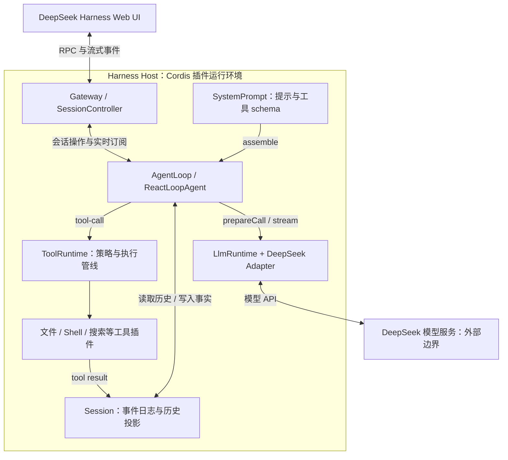

# DeepSeek Harness 最新开发版：源码架构与拆解页依据

核实日期：2026-09-18。用户指定学习真实 DeepSeek Harness，并选择最新开发版；不再采用通用 Coding Agent 五层架构。

实现进展：用户随后授权直接完成全部叙事，现已交付 [004 交互原型](../experiments/004-deepseek-harness/README.md)。本文后续“尚未”表述记录架构研究当时的状态；最终页面测试和视觉检查以该实验的验收记录为准。Harness 本身仍未运行，模型 API 未调用。

本次基线来自官方 `deepseek-ai/deepseek-harness` 的 `master` HEAD：[`ddefc45fbc7f8e46dd73185e68295696d1297887`](https://github.com/deepseek-ai/deepseek-harness/commit/ddefc45fbc7f8e46dd73185e68295696d1297887)，提交时间 2026-09-17 13:19:19 UTC，提交说明为 `release(dsh): 0.1.6-alpha.2` 的合并。这里的“最新”指本次查询时的开发分支 HEAD，不是对未来版本的保证。页面应显示分支、完整提交号与核实日期；更新基线须重核源码，不能静默混用不同版本。

验证方式：官方 GitHub API 取得 commit 与目录树；下载该 commit 的架构文档及核心源码到 [证据快照](./evidence/deepseek-harness/ddefc45/REVISION.txt)，核对函数调用和模块声明。GitNexus 当前索引未包含该仓库，因此未使用其他项目的图谱推断。未安装、启动 Harness，未接入 API key，也未执行真实模型请求；本次结论属于文档与静态源码核实。

## 真实结构，而非五道串行关卡

Cordis 管理插件的服务、事件、作用域与生命周期；Agent loop、session、system prompt、tool runtime、model adapter 等都是插件。它应作为贯穿架构的底座或连接骨架，而不是每次请求必经的一层。应用启动 profile 和 agent preset 决定加载哪些能力；它们属于组合配置，不是模型请求处理阶段。启动/UI 的详细源码证据见 [独立交叉核对](./deepseek-harness-plugin-evidence.md)。

图中 ToolRuntime、Session、SystemPrompt 等的横向位置仅为易读布局。事件日志、工具执行和模型请求存在多次往返，不能把摆放顺序直接当调用顺序。模型服务的神经网络内部不在 Harness 源码的本次核实范围内。

## 已核实的模块与代码位置

所有链接固定到同一 commit。

| 模块 | 真实责任与关键入口 | 证据 |
| --- | --- | --- |
| AgentLoop / ReactLoopAgent | 管理 turn、step、输入队列与循环；工具尚需后续请求时进入下一 step | [agent.ts L282–321](https://github.com/deepseek-ai/deepseek-harness/blob/ddefc45fbc7f8e46dd73185e68295696d1297887/packages/core/agent-loop/src/agent.ts#L282-L321) |
| SystemPrompt | 在 step 开始组装当前作用域下的提示、运行上下文与工具 schema；执行 pre-step 扩展点 | [agent.ts L241–255](https://github.com/deepseek-ai/deepseek-harness/blob/ddefc45fbc7f8e46dd73185e68295696d1297887/packages/core/agent-loop/src/agent.ts#L241-L255) |
| Session | append-only 事件记录；模型历史从有资格进入上下文的事件中投影，不是把所有遥测事件发给模型 | [Session README](https://github.com/deepseek-ai/deepseek-harness/blob/ddefc45fbc7f8e46dd73185e68295696d1297887/packages/core/session/README.md#design-concept) |
| LlmRuntime | `agent/request` 后绑定并准备适配器；由准备好的调用接收流 | [prepareRequest](https://github.com/deepseek-ai/deepseek-harness/blob/ddefc45fbc7f8e46dd73185e68295696d1297887/packages/core/agent-loop/src/agent.ts#L531-L542) 与 [stream](https://github.com/deepseek-ai/deepseek-harness/blob/ddefc45fbc7f8e46dd73185e68295696d1297887/packages/core/agent-loop/src/agent.ts#L380-L395) |
| DeepSeek Adapter | 官方 DeepSeek 路由 `deepseek-official`，通过 `ctx.llm.registerAdapter` 注册；Harness 同时支持其他适配器 | [llm-deepseek index.ts](https://github.com/deepseek-ai/deepseek-harness/blob/ddefc45fbc7f8e46dd73185e68295696d1297887/packages/llm/llm-deepseek/src/index.ts#L53-L57) 与 [注册 L133](https://github.com/deepseek-ai/deepseek-harness/blob/ddefc45fbc7f8e46dd73185e68295696d1297887/packages/llm/llm-deepseek/src/index.ts#L133) |
| ToolRuntime | `tools/pre-execute`、守卫、`tools/execute`、`tools/post-execute` 等执行阶段；策略可拦截，不保证所有调用都实际执行 | [tools index.ts](https://github.com/deepseek-ai/deepseek-harness/blob/ddefc45fbc7f8e46dd73185e68295696d1297887/packages/core/tools/src/index.ts#L1461-L1490) 与 [dispatch](https://github.com/deepseek-ai/deepseek-harness/blob/ddefc45fbc7f8e46dd73185e68295696d1297887/packages/core/tools/src/index.ts#L1573-L1600) |
| 工具循环 | 从 assistant message 提取 tool-call，交给调度器；无工具调用时可完成当前 step/turn 的相应工作 | [agent.ts L475–493](https://github.com/deepseek-ai/deepseek-harness/blob/ddefc45fbc7f8e46dd73185e68295696d1297887/packages/core/agent-loop/src/agent.ts#L475-L493) |
| 回显事件 | `agent/assistant-stream` 发出实时帧，持久消息通过 Session 保存；UI 路径由 SessionController 订阅与传输 | [agent.ts L380–395](https://github.com/deepseek-ai/deepseek-harness/blob/ddefc45fbc7f8e46dd73185e68295696d1297887/packages/core/agent-loop/src/agent.ts#L380-L395) 与 [界面证据](./deepseek-harness-plugin-evidence.md#界面与运行时的真实连接) |

## 演示的一次具体任务

建议问题：“这个项目的入口文件在哪里？请根据代码解释启动流程。”演示采用 Web profile 和 standard preset，模型路由显示 DeepSeek Adapter；具体模型 ID 必须以后续实际选择为准，不臆造固定默认型号。

1. UI 提交问题，Host 的会话控制入口接收，Agent 的输入队列出现待处理消息。
2. AgentLoop 打开 turn，领取输入，组装 prompt、上下文和可用工具定义，经过 pre-step。
3. 准备模型请求，把接纳的输入与必要请求事实写入 Session，从日志推导模型历史，再调用已绑定的模型适配器。
4. 模型流式返回一次回复；如果包含文件工具调用，运行时经过工具策略与执行管线读取项目文件。
5. 工具结果写入日志，下一 step 将结果带回模型。图上必须看得见这一回路；模型并不自行直接读本地磁盘。
6. 模型继续生成解释，实时帧通过运行时与会话控制接口回到 UI，最终消息记录在会话中。

这是一条依据代码设计的示例轨迹，尚未真实运行。页面必须显示“源码驱动的流程演示”，不能称为本机真实执行录屏或实时调试器。

## 对原始动画的修订

- 保留原始故事：面板 → 侧转成细边 → 向下展开 → 工具往返 → 模型信息流向上 → 面板复位 → 答案呈现。
- 首屏以 DeepSeek Harness 工作台为产品身份；视觉排版可参考桌面工作台，但不把 Codex 面板冒充 Harness 实际界面。
- 展开的薄板对应可核实的模块分组：UI/Host 接入、AgentLoop、上下文与日志、工具运行时、LLM 适配。其间用实际有向连线表达依赖和事件。
- Cordis 用贯穿模块的插件底座表现；profile/preset 是侧边配置说明，默认不占据请求主线的串行层。
- Session 用侧向记录轨道表现，关键事件落入轨道；工具在一侧展开并返回模型请求，避免为了美观删去回路。
- 最下方模型核心表示外部模型服务。淡蓝色二进制粒子是视觉隐喻；实际接口不是一团可见的 0/1。
- 真实 UI 可以在响应生成时增量显示。先复位面板再慢慢揭示回答是教学回放的镜头安排，不声称线上系统会等到最后才发送结果。
- 每个 hover/focus/click 说明含中文职责、真实包名、关键事件/函数、固定 commit 源码链接。模型服务说明明确公开代码边界。

## 第一轮视觉验收范围

只先确定首屏工作台与完整展开架构两种构图，再实现完整滚动叙事。首屏必须可读，拆解图必须能辨认主循环、工具支路、日志轨道与 Cordis 底座。继续沿用局部滚动展示窗口和可拖动章节刻度的方向；阅读停顿、反向恢复、手机点击替代悬停也保留。

后续浏览器截图按相同归一化时间轴进度取样，固定随机种子，记录视口和展示区域大小。尚未执行视觉验证，不能把静态源码核对作为动画已验收。
