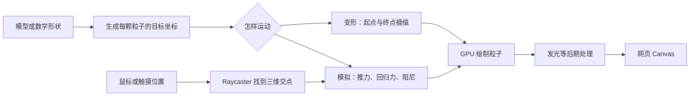

# 交互式 3D 粒子网页：从好看的案例理解实现

调研日期：2026-09-17。本页找的是有作者教程、源码或官方示例支持的代表案例；没有确认用户之前看过的 X 原帖，也没有核实这些案例在 X 上的传播热度。本次不修改图鉴、不制作简化复刻。

检索边界：按 agent-reach 路由尝试 Exa，遇到本机配置读取 EPERM，改用网页搜索和一手公开页面。以下“实现已核对”指已阅读教程、官方文档或源码，不代表已在所有浏览器和设备上体验通过。

## 先看三个不同类型

| 案例与直接体验 | 可以观察什么 | 一手实现资料 |
| --- | --- | --- |
| [Dreamy Particles：发光粒子面具](https://tympanus.net/Tutorials/DreamyParticles/) | 鼠标扰动后，粒子被推开，再重新聚成形；运动与发光共同构成质感 | [Dominik Fojcik 作者教程](https://tympanus.net/codrops/2024/12/19/crafting-a-dreamy-particle-effect-with-three-js-and-gpgpu/)、[作者源码](https://github.com/DGFX/codrops-dreamy-particles) |
| [TSL Morphing Particles：粒子变成不同物体](https://tsl-morphing-particles.vercel.app/) | 同一组粒子在不同模型的轮廓之间变化，适合认识 Particle Morphing | [作者仓库与实现解释](https://github.com/chrismaldona2/tsl-morphing-particles) |
| [Three.js Compute Particles：鼠标推动大量粒子](https://threejs.org/examples/webgpu_compute_particles.html) | 指针推动附近粒子，粒子受重力影响并在地面反弹；属于技术示例 | [Three.js 官方源码](https://github.com/mrdoob/three.js/blob/dev/examples/webgpu_compute_particles.html) |

前两个可以作为视觉方向参考，第三个适合理解大量粒子怎样计算；这里的用途分类是本项目的学习建议，不是作者的质量排名。

## 1. 粒子面具：看起来像“有生命的物体”

已核对作者教程：先从模型表面取点，把每个点的位置和速度保存为数据纹理；通过 `GPUComputationRenderer` 更新运动。鼠标通过 Raycaster 找到模型上的交点，附近粒子受到排斥，同时有回到原形的吸引力和阻尼。最后用 `Points` 绘制，叠加 Bloom 发光。[作者教程](https://tympanus.net/codrops/2024/12/19/crafting-a-dreamy-particle-effect-with-three-js-and-gpgpu/)

对设计的启发（本项目判断）：这里值得学的是“完整轮廓 → 局部被扰动 → 恢复”的节奏。粒子有归属、有反馈，画面才容易被理解；粒子数量本身不是设计目标。

## 2. 粒子变形：每颗粒子有一个新目的地

作者说明其实现先用 `MeshSurfaceSampler` 把每个模型采样为同样数量的点，写入 `DataArrayTexture`，顶点着色器根据变化进度混合当前与目标形状。示例还叠加噪声和摆动；这种“看起来有物理感”的变形不等于完整物理模拟。[作者实现说明](https://github.com/chrismaldona2/tsl-morphing-particles)

用于理解的公式是 `当前位置 = 起点 × (1 - 进度) + 终点 × 进度`。当进度为 0 时所有粒子在起点，为 1 时到达目标，中间帧形成过渡。这里解释的是插值思路，不是可直接复制的完整实现。

表面取点也不等于只使用模型原有顶点。Three.js 的采样工具可以在三角形表面随机取样；未指定权重时按面积分布，因此稀疏网格也能生成密集点云。[MeshSurfaceSampler 官方文档](https://threejs.org/docs/pages/MeshSurfaceSampler.html)

## 3. 大量粒子：GPU 不只负责把画面显示出来

官方源码把位置、速度和颜色存入 GPU 数据，计算步骤更新重力、摩擦和地面反弹；`pointermove` 经 Raycaster 落到不可见平面，交点附近的粒子获得向外推力。然后渲染这一帧。[官方源码](https://github.com/mrdoob/three.js/blob/dev/examples/webgpu_compute_particles.html)

证据细节：页面介绍写着“500k”，但本次读取的 `dev` 原始源码是 `particleCount = 200000`。页面与开发分支可能不同步，所以这里不把“50 万粒子”当作已验证运行规模，也没有作帧率或设备性能承诺。[页面](https://threejs.org/examples/webgpu_compute_particles.html)、[本次核对的原始源码地址](https://raw.githubusercontent.com/mrdoob/three.js/dev/examples/webgpu_compute_particles.html)

## 这些效果的共同结构

下面是教学抽象，概括上面几种实现；并不声称每个案例都经过全部步骤。

关键区别：**Morphing 是“要去哪里”，Simulation 是“受到哪些力、下一步怎样运动”**。二者可以组合，但“用了 GPU”不能自动证明存在物理模拟。

GPGPU 意为用 GPU 做通用计算。WebGL 的一种做法是把位置、速度编码到浮点纹理，用两组渲染目标轮流读取和写入，这叫 ping-pong。Three.js 的 `GPUComputationRenderer` 正是这种路径；WebGPU 示例则展示另一条计算路径。无需把 FBO、GPGPU、WebGPU 当成三种视觉风格，它们描述的是实现方式。[GPUComputationRenderer 官方文档](https://threejs.org/docs/pages/GPUComputationRenderer.html)、[WebGPU 示例源码](https://github.com/mrdoob/three.js/blob/dev/examples/webgpu_compute_particles.html)

Raycaster 解决的是“鼠标在二维屏幕上，究竟指向三维空间哪里”。给定指针坐标和相机，可以发出一条射线，再与模型或辅助平面求交。[Raycaster 官方文档](https://threejs.org/docs/pages/Raycaster.html)

## 如何准确描述给 AI

下面是本项目根据案例整理的描述范例，不是已实现的功能：

> 做一个鼠标可扰动的 3D 粒子雕塑（interactive particle sculpture）。初始粒子清楚组成一个面具；鼠标靠近时只推动局部，移开后带阻尼回到原形。保留有辨识度的轮廓和克制的发光，背景安静。提供低动态版本，并在真实手机上检查性能。

> 做一个粒子形态变换（particle morphing）页面，同一组粒子从球体变成鸟的轮廓，再变成品牌标志。每个形态先停留，让人看清；滚动控制变化进度。先确认每个目标形态的轮廓和转场节奏，再实现着色器。

面向本课题的判断：先选一个值得表达的形态和交互，再选择技术路线。一般球体、波浪等可以由数学规则生成；特定动物、产品或雕塑的精确轮廓通常需要合适的模型或采样数据。决定质量的还包括镜头、轮廓、粒子疏密、运动时序和留白；不能把已有球形点阵换颜色后当成这些案例的等价设计。
