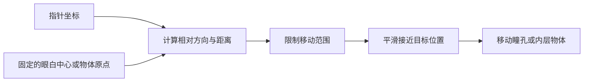

# 眼睛跟随与磁吸交互是怎么做的

2026-09-17。演示入口：[界面图鉴 → 组件动画](http://127.0.0.1:8768/)，最后两项。示例用于观察交互原理，不作为优秀视觉设计范例。

## 先学会描述

| 看到的效果 | 常见说法 | 具体行为 |
| --- | --- | --- |
| 小狗的瞳孔朝鼠标看 | Cursor-following eyes / 视线跟随 | 脸和眼白不动，瞳孔在眼白内部偏移 |
| 圆块或按钮靠近鼠标 | Magnetic interaction / 磁吸交互 | 进入一定范围后轻微吸引，离开归位 |
| 图形一路跟着鼠标走 | Cursor follower / 鼠标跟随 | 位置持续追踪指针，不一定存在吸引半径 |
| 背景和前景移动幅度不同 | Mouse parallax / 鼠标视差 | 多层内容使用不同的位移比例，产生纵深感觉 |

这里的 Eye tracking 是装饰性的眼睛动画，不是使用摄像头识别用户视线。磁吸是距离映射，也不必模拟真实物理。

## 一个共同的流程



HTML 放出可独立操作的部件，CSS 决定部件外观，JavaScript 根据指针位置更新 CSS transform。脸可以是图片，但要让瞳孔动起来，瞳孔必须是独立图层。当前小狗用 CSS 分层绘制，没有图片素材、3D 模型或动画库。

通过 [pointermove](https://developer.mozilla.org/en-US/docs/Web/API/Element/pointermove_event) 收到指针事件，用 `clientX/clientY` 获得视口坐标；[getBoundingClientRect()](https://developer.mozilla.org/en-US/docs/Web/API/Element/getBoundingClientRect) 提供同一坐标系中的元素位置。两者相减，得到相对方向。不要混用页面坐标与视口坐标。

```js
const rect = eyeWhite.getBoundingClientRect();
const dx = event.clientX - (rect.left + rect.width / 2);
const dy = event.clientY - (rect.top + rect.height / 2);
const distance = Math.hypot(dx, dy);
const travel = Math.min(distance * 0.1, 12); // 示例移动上限 12px
const x = distance ? dx / distance * travel : 0;
const y = distance ? dy / distance * travel : 0;
pupil.style.transform = `translate(${x}px, ${y}px)`;
```

这段是即时定位的核心示意。完整实现还根据眼白与瞳孔尺寸收紧上限，防止瞳孔穿出边界，并处理离开、缩放、触屏、键盘和动画销毁。

## 磁吸再加一条距离规则

本示例以不移动的画布中心为原点，感应半径是短边的 42%。设距离为 `d`、半径为 `R`、强度为 `s`：

```js
const falloff = Math.max(0, 1 - d / R);
const targetX = dx * s * falloff * 1.8;
const targetY = dy * s * falloff * 1.8;
```

例如指针在原点右方 80px、半径 146px、强度 45% 时，物体目标位移约为右移 29px。指针在范围外时 `falloff` 为零，物体回到原位。这是一种可调的视觉模型，并非唯一或标准公式。

必须测量**不移动的外层**，再移动内层。若不断拿已经移动的按钮作为基准，就容易出现吸引方向变化和抖动。

## “有手感”来自平滑过程

直接把位置设为目标点，会立即到位。平滑跟随则每帧只走完剩余距离的一部分：

```js
// dt 为本帧与上一帧的毫秒间隔；85 是这次示例的响应时间参数。
const alpha = 1 - Math.exp(-dt / 85);
currentX += (targetX - currentX) * alpha;
currentY += (targetY - currentY) * alpha;
```

这会呈现一点滞后感，属于平滑插值；若要明显回弹、过冲，需要另一套弹簧模型。示例用 [requestAnimationFrame](https://developer.mozilla.org/en-US/docs/Web/API/Window/requestAnimationFrame) 配合浏览器绘制节奏，稳定后停止请求新帧，关闭介绍时取消动画。

可以在图鉴里开关「平滑跟随」直接比较这两种状态。开启「原理辅助线」会显示目标点与方向，方向按钮让没有鼠标时也可以观察。

触屏采用轻点定位，保留页面滚动，不要求悬停。暂停动效时鼠标连续跟随停止，方向按钮仍能静态改变位置。正式产品中的主要操作不应该因为装饰动画而变得难以点击。
