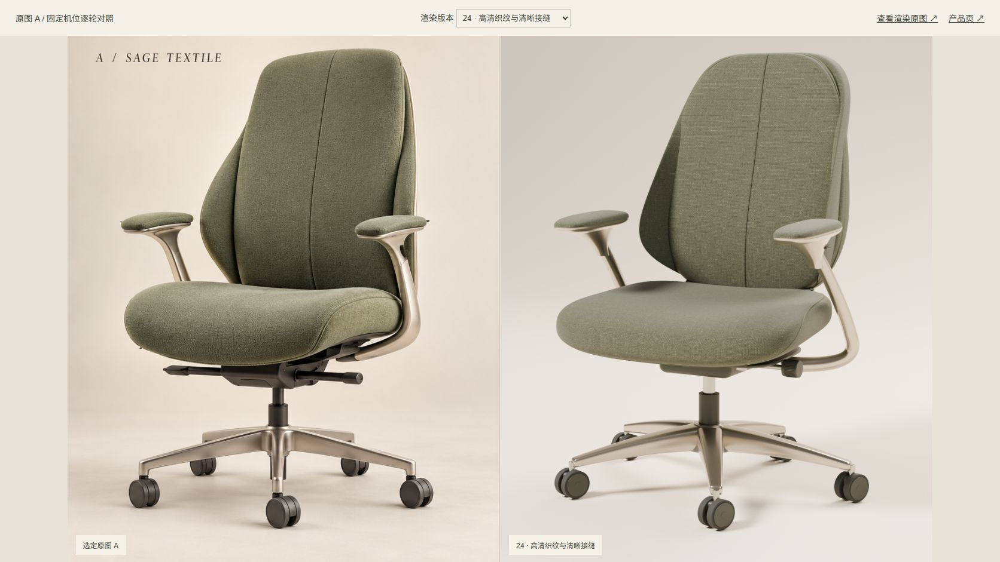
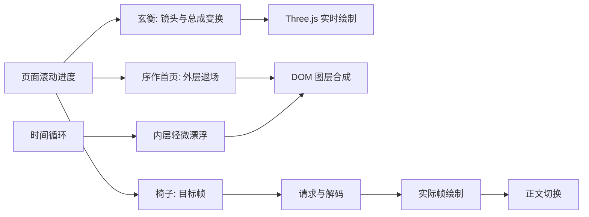

# 从画面好看到可交付：玄衡与序作的设计复盘

这是两次实际迭代的学习记录，不是通用审美定律。证据来自用户的持续反馈、当前源码和原开发截图；没有跨行业转化率或用户测试数据。整理于 2026-10-14。

入口：[玄衡加工叙事](../experiments/009-xuanheng-craft/README.md)、[序作公司与椅子](../experiments/010-xuzo-chair/README.md)。建议先运行，再按本文定位源码。两者从 AI-Office-Case 的案例 17、18 复制，原项目保留。

## 先决定网站在介绍谁

玄衡最初通过加工、成品特写制造视觉冲击，但大量镜头在介绍零件，公司只是结尾文字。“验收什么，在实施前说清楚”又像项目沟通话术，无法迅速回答访客的疑问：这家公司做什么、服务谁、有什么能力。

后来把企业定位、核心业务、工程能力、服务支持展开。序作进一步把两种任务分开：公司主页讲舒适的价值观和日常空间，产品页专门解释椅背、座面、扶手。这不是把产品隐藏起来，而是给不同访问意图合适的入口。

**下一次可直接做的动作**：在写分镜前，为每一幕写一句“读者看完应知道什么”。若公司首页连续数幕的答案都是产品结构，就调整内容占比。没有依据的资质、客户数量、性能数字不能用于填满画面。

## 把创意写成不能在迭代中丢失的约束

本次出现过一个偏差：用户说减少产品画面，实现却换掉了已经认可的动效方向。因此，在迭代开始前保留一份简短的方向约束：

- 公司主页初始有多种家具围绕品牌内容，不要求真实重力朝向。
- 停留首屏时持续轻微漂浮；向下滚动后家具向画面外退出。
- 文字正常横排，不贴在桌面纹理上，也不为适应家具倾斜而变形。
- 椅子在首屏悬停/聚焦时给出提示，点击进入产品页。
- 产品页保持右侧产品构图，滚动主导镜头，用户不控制自由相机。

修改前说清“保留哪些、只改哪些”，比重新生成一个漂亮但不同的方案更有用。产品颜色或造型改变时，公司入口也要同步，否则两个页面像不同品牌。

## 留白不是背景颜色决定的

本次白底版本曾显空，后来通过家具、木色、织物、生活场景和有层次的内容建立密度。不能由此推断“白底必须填满、黑底可以随便空”。真正影响画面的是视觉重量、对比、主体比例与空白是否帮助阅读。

白底孤立一个无细节的模型，空白会放大模型缺陷。深底银色零件有高对比轮廓，大片暗部更容易读成摄影棚空间。两者都要控制主次。装饰优先来自品牌材料和场景；只有具有并列、分组意义的内容才做卡片，不能为了填空把所有段落装进同样的卡片。

可用方法：先缩小截图看视觉重量，再放大读正文。缩小时只有产品、放大时文字仍没有组织，说明不是再添一个装饰就能修好。

## 文案与物体需要同一个构图计划

玄衡的白色零件与白色文字重叠，属于对比和遮挡问题；序作的文字贴左边，右侧动效持续抓住视线，属于注意力距离问题。它们不能用同一个“放大字号”方案处理。

序作最终保留产品位置，仅将桌面正文左起点移动到约 20vw；玄衡在细节镜头中预留正文空间。这里的 20vw 和原检查使用的 36px 间隔是该构图的参数，不是可复制到所有屏幕的规范。

检查静态首屏之外，还要看运动中间帧：高亮边缘是否穿过正文、最长标题是否进入产品范围、缩短窗口后正文与底部内容是否挤在一起。关键对象走过的区域应当提前视作不可排字区域。

## “塑料感”先拆成可定位的问题

| 观察到的现象 | 本次对应的排查方向 | 不能替代的工作 |
| --- | --- | --- |
| 像光滑玩具 | 轮廓、倒角、厚度、连接件、材质粗糙度差异 | 只提高 metalness 不会生成真实结构 |
| 金属平灰 | 环境反射、主光方向、明暗面、接触阴影 | 加曝光不能补出缺少的反射信息 |
| 椅背像透明纱网 | 材质不透明性、真实织物组织、边缘厚度 | 换背景不能解决网布透出机械件 |
| 与批准图不像 | 固定相机后比较轮廓、体积、扶手曲率、比例 | 打光不能把错误轮廓变正确 |
| 接缝模糊或像画线 | 线迹贴合、缝线宽度/颜色、织纹尺度、侧光、像素分辨率 | 单纯锐化不能恢复缺少的几何细节 |

序作的实际调整包括：不透明鼠尾草绿织物、香槟金属、贴合表面的缝线、缩小主光面积、收敛织物大块噪声、提高输出分辨率。仍有形体差异，必须保留在记录里。

## 对照要高频，完整渲染要低频

本次多轮修改曾改变了已经确认的形状。更稳妥的过程是：锁定参考 A 图和参考相机，每次集中修改一类问题，先输出单张样片；观察通过，再检查整椅、爆炸、椅背、座面和扶手，最后才渲染整段。

记录“观察 → 改动 → 同机位截图 → 剩余差异”，而不是用“更高级、更真实”作为验收标准。轮廓、材质、灯光分开讨论；参考图没显示的背部属于补建，不能声称来自原图。

GPU 不能只看配置字段。当前 build.py 选择 OptiX，枚举并启用设备，打印实际后端与降噪器，没有可用设备就停止。异机重建要再次核对环境；网页浏览使用已渲染素材，不需要浏览器做 Cycles 运算。

## 动效技术围绕展示任务选择

| 任务 | 本案例选择 | 得到什么 | 承担什么 |
| --- | --- | --- | --- |
| 六件家具在品牌文案周围漂浮 | 透明图片 + CSS/JS 2.5D | 画质稳定，易排版，持续轻动 | 无法看到图片背面，旋转要克制 |
| 机床工具协同、空间位移 | Three.js 实时场景 | 独立总成、镜头与动作连续变化 | 建模、材质、照明与浏览器性能都要打磨 |
| 固定椅子分解与细节镜头 | Blender 离线序列 + Canvas | 同一材质、同一镜头输出可控画质 | 下载体积、解码内存、重渲染成本；不能自由旋转 |

本次没有得出“Three.js 做不到真实感”或“Blender 必然更好”的结论。序列适合这里的固定镜头，实时场景适合需要独立控制多个部件的机床叙事。生成概念图能帮助选方向，不能自动生成可信的多角度模型。

## 两种时间不要互相覆盖

首屏漂浮是时间驱动，家具退出是滚动驱动。若二者同时修改同一个 transform，容易互相覆盖。序作以外层元素做退场、内层 `.furniture-drift` 做闭合漂浮循环；不同物体使用不同相位与幅度。hover/focus 暂停椅子漂浮，帮助点击；离开场景或隐藏标签页后暂停，不必整页一直运行。

“退出”保持实体不透明、沿明确方向移动；“淡出”改变透明度。本次用户拒绝了粒子消散与残影，因此不能把廉价的 opacity 过渡当作同义实现。

## 序列流畅度也包含内容一致性

椅子共 241 帧，每帧 2560×1600。单张 RGBA 位图约 15.6 MiB，若全解码会接近 3.7 GiB；因此源码限制最多 12 张解码位图，约 187.5 MiB 的像素数据量级。该估算不包括 Canvas、压缩 Blob、GPU 与浏览器额外开销，不能当作进程实测内存。

快速反向滚动时，先发出的请求可能后完成。播放器只绘制仍匹配当前目标的结果；正文使用实际绘制帧的回调更新，避免椅背画面还没到、文字已经说座面的错位。后台压缩帧预取与解码缓存是两种不同资源，不能只数请求数量判断内存。

关注 [chair-sequence.js](../experiments/010-xuzo-chair/src/chair-sequence.js) 的 wanted/displayed、trim、onFrame、pagehide；再看 [main.js](../experiments/010-xuzo-chair/src/main.js) 的滚动平滑与失败海报。测试要有快速正向后立刻反向，不能只匀速从头滑到尾。

## 学习界面与客户界面各有位置

“01 椅背”、底部逐幕按钮、探索/重看等控件有助于测试，却可能抢占品牌页面注意力。序作最终去掉这类导航，保留实际公司导航、产品入口和咨询。调试进度留在只读诊断对象或独立记录里，不必向访客解释渲染实现。

删除控件也要保留可访问性：椅子入口可键盘聚焦，隐藏章节不应继续抢焦点，减少动态效果时内容仍可读。不要为了“干净”删掉用户真正需要的入口。

## 把验收设计成可重复的观察

一次迭代的最小闭环：确定本轮改动 → 构建 → 实际浏览器 → 固定视口/滚动位置截图 → 对照修改 → 重测受影响的部分。建议先核对 1440×900，再检查较窄和较宽桌面；不能只放大开发窗口看首屏。

检查项目：进入与返回、悬停和键盘聚焦、正反滚动、最长文案、物体经过正文的帧、资源失败、减少动态效果、横向溢出与控制台错误。截图注明它属于原开发还是本轮迁移；历史通过不能直接写成本轮全部通过。

## 把经验交给下一个 AI 时

短提示词可以成立，前提是工程里有信息源、视觉约束、真正的资源和验收要求。只写“高级、酷炫、有质感”不会指定轮廓、信息层级与失败处理。可复用的任务说明：

> 先阅读现有品牌内容与素材，保持公司主页和产品页职责分开。保留已确认的构图和配色，先完成首屏与一段详情并在真实浏览器对照截图，再扩展。滚动决定镜头，正文保持可读。不要编造产品参数。完成时报告实际验证结果和仍有的视觉差异。

这是方法提示，不保证不同模型一次产出相同画面。尤其不能把构建成功、素材齐全、Skill 安装成功当作视觉质量通过。

## 下次练习

1. 在序作里只移动正文，不移动产品，比较两个桌面宽度的阅读距离。
2. 修改内层漂浮周期与相位，观察是否变成整齐摆动，记下舒适与分散注意力的边界。
3. 在玄衡里依次关闭环境反射与接触阴影，固定同机位截图，分辨形体、材质和灯光各自贡献。
4. 保持椅子帧不变，故意让正文按目标进度切换，对比快速反向时的错位，再恢复实际帧回调。

这些是建议的后续实验，并未在本次迁移中全部执行。用独立分支保存截图和观察，不用未经验证的猜想覆盖现有结论。
