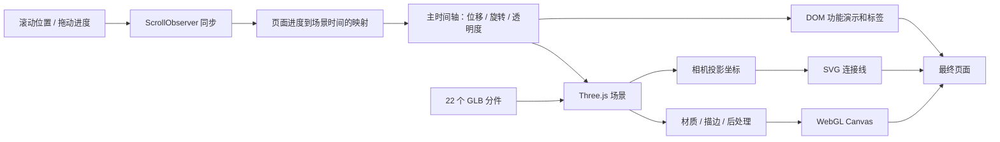

# 从 Anime.js 首页理解动画引擎

先把两件事分开：**3D 渲染器决定一个状态长什么样；动画引擎决定这个状态什么时候变成什么样。** 首页的效果是二者加上素材、排版和叙事共同形成的。

下面“原站观察”来自本次实际页面与已加载源码；“设计建议”是我们据此提出的工程判断，不表示原站所有内部实现都已验证。

## 这台装置是怎样形成的

**原站观察**：页面的 `canvas#renderer` 标记 `three.js r172`。主脚本加载 22 个 GLB 分件及 Draco 解码器，通过材质、描边/后处理得到机械轮廓和发光效果。文字标签使用 DOM 渲染器，连线来自 SVG，而不是全部画进同一个 Canvas。资源和 DOM 证据见 [source-manifest.json](../source-manifest.json) 与 [source-layout.json](../../../docs/evidence/anime-replica/source-layout.json)。



**原站观察**：主时间轴中保留了 `HEADING_END`、`TOOLBOX`、`FEATURES`、`MODULES_TRANSFORM`、`MODULES_SHRINK`、`MODULES_CASE` 等标签。DOM 各段高度参与进度映射，滚动同步配置包含 `sync: .9`，再通过 `seek()` 驱动场景。这里的 `.9` 是该 API 的同步设置，不能直接解释为固定 0.9 秒延迟。官方 [onScroll 文档](https://animejs.com/documentation/events/onscroll/)说明它连接滚动与计时器、动画、时间轴。

所以这类页面更准确的设计关键词是：

- **Scroll-driven storytelling**：滚动驱动叙事。
- **Exploded view**：分件拆解视图。
- **Choreographed animation**：多对象协同编排。
- **Pinned / sticky scene**：视口中持续保留的场景。
- **Scrubbing**：把滚动条或滑块作为动画播放头。
- **Hybrid rendering**：WebGL、DOM、SVG 组合呈现。

## 为什么它看起来像一个完整设计

这是本次观察形成的设计判断：

**贯穿整页的主体**让功能介绍有共同参照。旋转、散开、重组都发生在同一台机器上，用户无需反复理解新的画面。

**颜色有职责**：模块和演示拥有对应的强调色；低饱和背景给这些颜色留出空间。颜色并非只是在卡片上换皮肤。

**材质服务于讲解**：暗色与发光适合吸引注意，浅色线稿适合看内部结构。切换发生在内容意义变化的位置。

**文字并不一直抢镜**：标题、代码卡、模型和指示线错开出现，且滚动中存在可以停下来看的构图。真正值得迁移的是这个编排逻辑。

这次复现保留了原作者编排，因此证明的是资源适配与复现能力，尚未证明我们能独立设计同等质量的叙事。

## 自己写动画引擎，优先解决什么

### 1. 统一时钟与确定的状态

设计建议：所有轨道读同一个时间；引擎集中调度。官方 [Engine 文档](https://animejs.com/documentation/engine/)也把同步动画、计时器和时间轴作为引擎职责。

不要让运动速度依赖显示器帧率。两个具体写法的区别：

```js
// 每帧累加：60 次调用与 120 次调用走出的距离不同，也不能直接倒放。
x += 2;

// 按时间取样：t = 1500ms 时总得到相同值。
const p = Math.max(0, Math.min(1, (t - start) / duration));
x = from + (to - from) * ease(p);
```

我们的小引擎采用第二种，测试用两组不同帧间隔跑到同一时间，比较取样值。[实现](../src/mini-engine.js)不依赖 DOM，因此可以用假时钟验证，而不是靠肉眼猜。

### 2. 跳帧、倒放与回调不是一回事

位置可以由 `value = sample(time)` 重算。但如果从 1 秒跳到 5 秒，中间 3 秒的“播放声音”回调要不要执行？倒放时执行哪一种？重复拖动会不会重复发请求？

设计建议：区分渲染取样和有副作用的事件；为 `seek` 是否触发回调、跨区间的触发次数、反向播放语义设明确规则。教学引擎刻意不实现跨越事件，也不暗示已解决它。

### 3. 轨道冲突要有可解释规则

同一时刻，入场动画、鼠标吸附、拖动都可能修改 `transform`。两个直接写入者会互相覆盖。

```js
// 两个系统覆盖整串 transform：后执行者抹掉前一个的位移。
element.style.transform = 'translateX(80px)';
element.style.transform = 'rotate(20deg)';

// 一个输出阶段统一组装已计算好的状态。
const state = { x: 80, rotate: 20 };
element.style.transform = `translateX(${state.x}px) rotate(${state.rotate}deg)`;
```

设计建议：明确替换、叠加、混合与优先级。我们的教学引擎暂时拒绝同名属性的第二个轨道；这是一种明确的能力边界，不是完整 composition 系统。

### 4. 缓动、弹簧、拖动各有不同状态

缓动是进度到进度的函数。弹簧通常涉及位置和速度；拖动还涉及指针采样、容器坐标、释放速度和边界。一个回弹曲线不能代表完整的物理系统。

教学页提供 `outBack`，明确标成“越过终点再返回”，不把它叫作真实弹簧。首页绿色圆盘则保留原站 Draggable 行为。

设计建议：一旦做物理积分，要定义时间单位、最大步长、后台恢复策略与停止阈值。选择固定步长模拟或解析解，要根据可复现性与交互需求验证，不应只调到某一台机器上看着顺眼。

### 5. 布局变化意味着时间轴输入变化

**原站观察**：1280×720 视口下页面高度为 16,913 px；390×844 下为 20,041 px。小屏不仅缩小字，还改变了文本、主体和控制区的相对布局。

字体加载、换行、横竖屏、窗口尺寸会改变触发点。设计建议：集中读取布局、重算区间，再批量写入状态；不要在每个对象的每一帧里反复读 `getBoundingClientRect()`。

官方 [Scope 文档](https://animejs.com/documentation/scope/)给出了响应媒体查询与成批撤销实例的能力。框架组件卸载时要撤销监听和动画实例；仅把 DOM 移除不代表 GPU、定时器或监听自动释放。

### 6. 3D 管线的代价要单独核算

模型、解码器、材质、阴影与后处理影响画质和开销。图像分辨率按宽高同时增加时，像素数量随面积增加；高 DPR 的多次后处理不能只凭“模型面数不高”判断成本。

设计建议：测 CPU 帧时间、GPU 时间、绘制次数、可见物体与内存；为不可见页签、低性能设备、WebGL 不可用和 reduced motion 制定策略。本次未做低端真机性能压测，因此不写“稳定 60 fps”。

卸载时分别考虑 geometry、material、texture、render target、worker。Three.js 的 [GLTFLoader 文档](https://threejs.org/docs/pages/GLTFLoader.html)特别提醒 image bitmap 的释放不能只依靠对象不再被引用。

### 7. 类型与错误边界决定引擎是否可靠

动画输入需要防止 `NaN`、无穷大、负时长、零时长除零和单位不一致。本次在原站与本地均观察到几何包围球 NaN 警告，说明视觉正常不等于数值路径完全健康。

教学引擎对时间、速度和轨道数值做有限值检查，测试反向终点、重复 play、pause 取消调度和 dispose 后不再写值。生产引擎还需覆盖颜色空间、相对值、数组目标、文本拆分、SVG、WAAPI 和自定义渲染适配器。

## 给 AI 描述下一次设计，可以这样写

> 做一个滚动驱动的产品拆解页。先确认一个真实分件模型，让同一主体贯穿整页：首屏正面展示，滚动旋转到斜侧面，再按结构层次沿轴向拆开。结构说明阶段切换浅色描边材质，标签用 DOM，连接线跟随相机投影。保留可停下来阅读的状态。先验证首屏和拆解构图，再扩展功能段落；每个断点用相同滚动位置对照截图。

这里描述了主体、镜头、运动方向、材质变化、信息层次和验收方式，比单说“高级、炫酷、3D”更可执行。这是本次总结的工作方法，仍需要后续原创案例检验。
