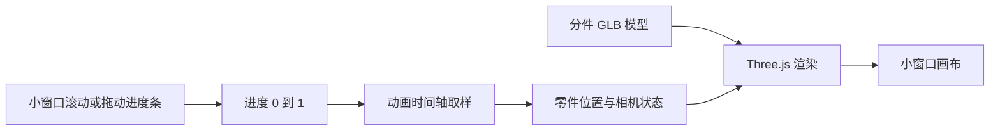

# 将拆解动画放进页面中的小窗口

2026-09-18 讨论记录。本文为可行性分析与建议，尚未将现有首页改造成嵌入式组件。

## 模型资源和前端代码各自做什么

本地复刻的 `public` 下实测有 22 个 `.glb` 文件，还包含 Draco 解码器、字体和渲染代码。素材已经随实验保存在本地，观看不需要安装建模软件。资源清单见 [source-manifest.json](../source-manifest.json)。

GLB 保存几何体、分件与材质等场景数据；Three.js 将场景渲染到画布；Anime.js 时间轴编排位置、旋转、相机及其他数值的变化。简单立方体、球体和参数化粒子可以用代码生成，复杂精细的产品通常使用模型资源。拆解应预先具备能独立控制的零件；一个合并后的外壳模型不保证具备真实内部结构。

## 局部滚动的交互约定

将“鼠标滑动”按滚轮或触控板滚动理解：指针在窗口内，滚动推进拆解；指针在外面，滚动普通页面。如果需要鼠标移动而无需滚轮，则属于另一个输入映射，可以用指针横向位置驱动进度，但需要额外定义移入和移出的连续性。

Anime.js 的 [onScroll container](https://animejs.com/documentation/events/onscroll/scrollobserver-settings/container/) 可绑定局部元素。容器设置固定可见高度、`overflow-y: auto`，内部保留足够滚动长度；3D 画面固定在该可见区域中，滚动长度负责推进时间轴。

容器的 `overscroll-behavior-y: contain` 用来阻止滚到底后继续带动外层页面。鼠标移到外部后页面正常滚动。需要验证滚轮、触控板、键盘和触屏各自的事件目标。[MDN 说明](https://developer.mozilla.org/en-US/docs/Web/CSS/Reference/Properties/overscroll-behavior)

## 自定义进度条和浏览器滚动条

复刻首页中的 `.scroll-bar`、`.scroll-cursor` 是页面自己构造的时间轴导航控件，拖动后会写入 `document.scrollingElement.scrollTop`。它不是浏览器滚动条的现成皮肤，也不是调用 Anime.js 即可得到的通用滚动条组件。

可以把同类控件放在小窗口底部，滚动时更新指示器；拖动指示器时反向更新窗口滚动位置。输入源共用一个进度状态，避免拖动与滚动相互重复驱动。

三种实现层次：

| 方式 | 行为与代价 |
| --- | --- |
| 调整原生滚动条颜色、宽度 | 简单，复杂刻度、章节标签等造型受限制 |
| 隐藏原生滚动条外观，添加自定义控件 | 保留原生滚动机制；适合这个局部展示窗口 |
| 拦截输入，自行模拟所有滚动 | 自由度高；需要自己处理键盘、触屏惯性、焦点、锚点与位置恢复 |

`scrollbar-width: none` 隐藏外观但元素仍可滚动。隐藏后必须提供明显、可键盘操作的替代控件，避免只能靠滚轮找到交互。[MDN 说明](https://developer.mozilla.org/en-US/docs/Web/CSS/Reference/Properties/scrollbar-width)

## 对现有复刻的改造边界

当前首页动画绑定 `document.body`，读取 `window.innerHeight` 和文档滚动高度，不能只在外面包一个小 `div` 就完成隔离。

快速复用的候选方案是用同源 iframe 承载本地复刻，让它拥有独立视口和滚动文档。需在 iframe 内的 `html` 与 `body` 上设置 overscroll 行为，仅给 iframe 元素设置无效；同时检验原站在小尺寸下的构图。

长期可复用的方案是独立封装 viewer：使用容器尺寸计算相机比例和画布大小，将所有滚动绑定到容器，统一处理 ResizeObserver、暂停与资源释放。小窗口不会自动减少模型资源或场景计算量。

建议展示结构：上方场景，中间短说明，底部自定义章节刻度与拖动滑块；初始提示“在此滚动探索”，提供重置和全屏入口。外层页面暂保留普通滚动。这是建议，不是用户已经确认的实现方案。
