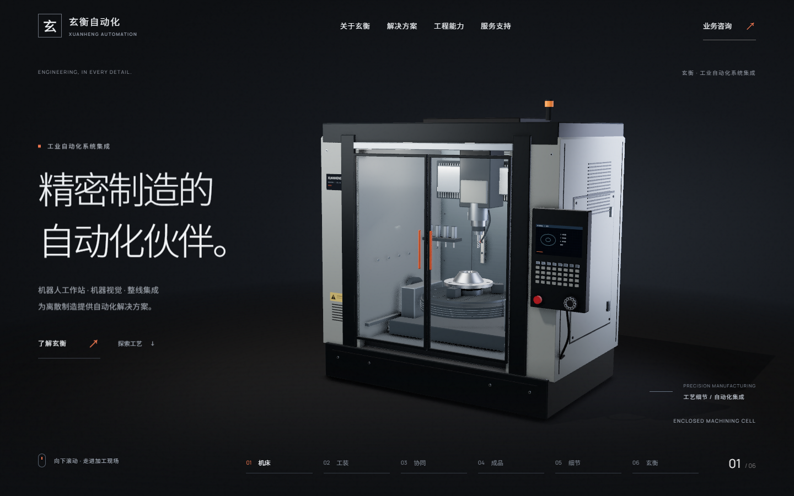
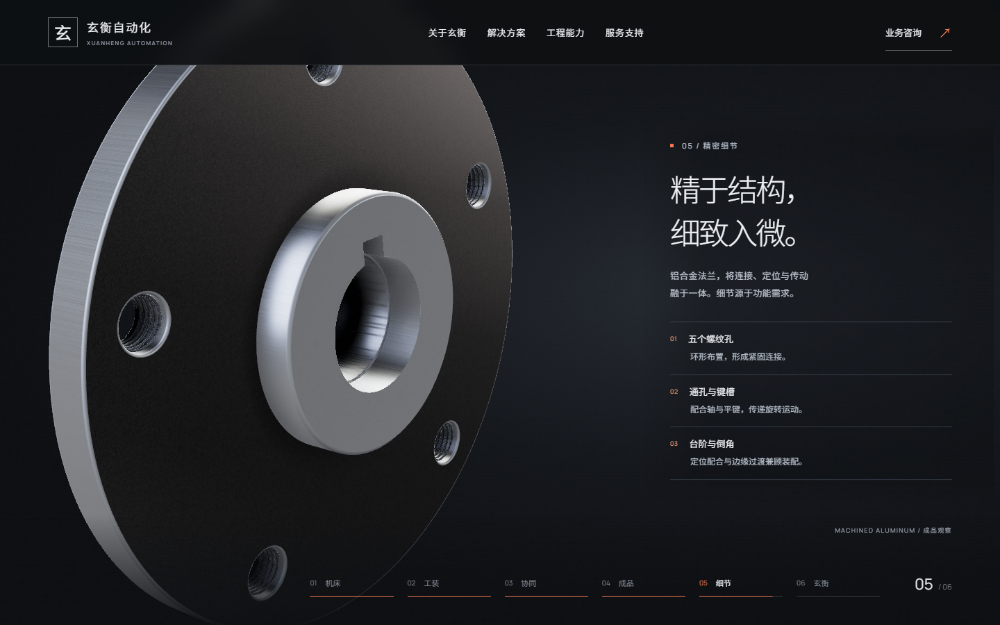

# 009 · 玄衡：以加工过程讲述企业能力



桌面端工业公司官网实验。滚动控制预设镜头：机床全貌 → 进入加工区 → 加工 → 设备实体退场 → 零件细节 → 企业介绍。用户没有自由相机控制。品牌、设备重建与业务文案均为演示设定。

## 运行

安装 Node.js 24 LTS 后双击 **启动零件制作.cmd**。首次自动安装依赖并构建。或在本目录执行：

```powershell
npm ci
npm run dev
```

开发默认 http://127.0.0.1:3197/ 。成品预览：`npm run build` 后 `node preview.mjs`。端口占用时，静态预览会选择其他端口，请读取控制台地址。详见[部署说明](部署说明.md)。

## 建议学习顺序

1. 先看整段转场：哪些动作说明加工，哪些动作只为了官网叙事。
2. [index.html](index.html)：公司定位、核心业务、工程能力与咨询内容。早期只有加工展示，后续补齐企业身份。
3. [src/timeline.js](src/timeline.js)：刀具先退开、夹具松开、设备向外退出的顺序。
4. [src/scene.js](src/scene.js)：镜头、HDR 环境、后处理、画面中的正文避让。
5. [src/machine.js](src/machine.js) 与 [src/assembly.js](src/assembly.js)：机床和法兰的形体、细部与材质分组。
6. [src/main.js](src/main.js)：滚动进度、加载失败降级与本地咨询资料下载。



## 本例教会我们什么

“塑料感”不能只通过增加金属度解决。轮廓倒角、紧固件、钣金厚度、金属粗糙度、可反射的环境与接触阴影共同影响判断。白色零件进入白字区域时，应调整构图与正文空间，而非只给字加阴影。

“消散”与“退出”会导向两种实现。本例要求部件持续不透明，以位置变化退出画面；不要用残影、溶解或透明度把设备抹掉。退场是表现手法，不是实际机床拆解工序。

现实结构参考与授权见[原案例记录](历史开发记录.md)、[公司内容调研](references/公司主页内容调研.md)及 public/licenses。网页使用程序重建的实时 Three.js 场景；分镜概念图不能当作浏览器质量证据。

## 验证与边界

迁移前的桌面证据见 [验收说明](evidence/验收说明.md) 和 evidence/company-v5；这批截图属于原开发过程。本次迁移检查单独记录在[迁移验证](迁移验证.md)。

未开展移动端验收，无真实咨询后台，无公网部署。样件不是制造 CAD，也不包含经验证的加工参数。该案例动画比例较大，仍可作为“公司介绍如何避免被产品夺走主导”的对照样本；不要把它当成所有企业官网的通用首页模板。

跨案例总结：[从画面好看到可交付](../../docs/xuzo-xuanheng-design-lessons.md)。
