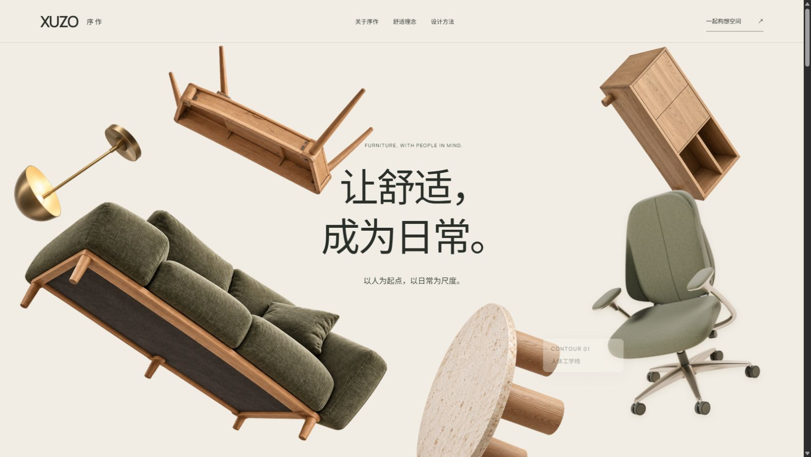
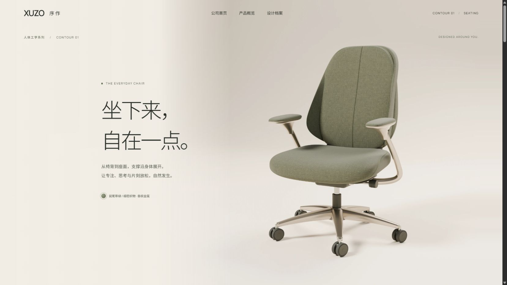

# 010 · 序作：公司叙事与产品细节分开设计



暖纸色、鼠尾草绿、自然木色与香槟金属的家具概念品牌。公司首页讲述舒适理念、设计方法与愿景；人体工学椅拥有独立产品详情页。这里迁移的是已实现的主页与一款椅子页，不是后来知识库 Skill 规划的六款详情页。

## 运行

安装 Node.js 24 LTS 后，双击 **启动家具官网.cmd** 或 **启动人体工学椅.cmd**。首次会检查环境、安装依赖并构建。命令行开发：

```powershell
npm ci
npm run dev
```

默认入口 http://127.0.0.1:3199/ ，产品页 `/products/contour-01/`，造型对照 `/review/`。构建后运行 `node preview.mjs` 可预览 dist。详见[部署说明](部署说明.md)。站点使用根路径资源，需要独立 origin 或反向代理根路径；不能直接双击 HTML 或原样挂在 URL 子目录。

## 当前实现，不要与早期试验混淆

| 页面 | 实际技术 | 展示能力与边界 |
| --- | --- | --- |
| 公司首页 | 透明 WebP 家具 + CSS/JS 2.5D 动效 | 停留首屏持续漂浮，滚动时实体移出；图片不能真实转出新背面 |
| 椅子详情 | Blender Cycles 离线渲染 + Canvas 序列 | 241 帧、2560×1600，整椅、展开、椅背、座面、扶手、复原；固定镜头，可反向滚动 |
| 历史源码 | Three.js 网布椅、房间试验 | 仅供对照，当前椅子页不加载旧 GLB |



## 从这些文件开始学

- [company-page.html](company-page.html)：公司主页内容主源；[scripts/sync-pages.mjs](scripts/sync-pages.mjs) 在开发/构建前同步两个入口。不要分别编辑三份 HTML。
- [src/floating-home.js](src/floating-home.js)、[src/floating-home.css](src/floating-home.css)：外层负责滚动退场，内层负责持续漂浮，椅子 hover/focus 负责入口反馈。
- [products/contour-01/index.html](products/contour-01/index.html)、[src/style.css](src/style.css)：产品页文案与构图。保留产品位置，把正文移近；移除面向测试的幕号与操作导航。
- [src/main.js](src/main.js)、[src/chair-sequence.js](src/chair-sequence.js)：滚动映射、实际帧回调、预取、12 张解码位图上限、快速反向处理与失败海报。
- [model-source/contour-sage/build.py](model-source/contour-sage/build.py)：当前造型、织物、接缝、灯光、镜头与部件动画。
- [references/contour-sage.md](references/contour-sage.md)：参考 A 图到第 24 轮的校准过程，包含没有解决的造型差异。

## 需要重新渲染时

网页运行无需 Blender。仓库保留 `.blend`、当前 build.py、sage-weave.png 与编码脚本；省略原始 PNG 缓存和旧房间的建模资料。build.py 使用 Python 的 `bpy` 5.1 API，并要求可用的 OptiX GPU；无可用设备时明确失败，不会偷偷回退 CPU。需要在已安装匹配 bpy 的 Python 环境中运行（普通 Node 环境无法运行）：

```powershell
python model-source/contour-sage/build.py reference --label review
# 先观察固定机位样片，确认后才重渲染全序列
python model-source/contour-sage/build.py sequence --count 241
python model-source/contour-sage/build.py home
python model-source/contour-sage/pack_assets.py
```

编码脚本还需要 Pillow。重建脚本按自身位置读取织物，已移除原电脑私有 Python 包路径。已有 blend 内的历史纹理路径如失效，可重连同目录 sage-weave.png，或用脚本重建。此次迁移不重新渲染，不能视作异机 GPU 重建验收。

## 证据与局限

[detail-v7](evidence/detail-v7/changes.md) 是最终文字位置与清晰度记录；floating-v5 保留持续漂浮阶段证据，其中旧椅子外观不是当前产品。public/review 保留原图和各轮对照。更早的过程描述见[历史开发记录](历史开发记录.md)，其中部分旧截图/旧模型目录未迁移，以本 README 为当前入口。

这是按单张图重建的近似产品。扶手曲率、侧翼体积、局部缝边仍有差异；清晰度改善不等于一比一还原。公司与产品为概念设定，场景图不是实拍客户案例。当前只验证桌面，无真实咨询后台。

本次[迁移验证](迁移验证.md)与原开发截图分开记录。跨案例总结：[从画面好看到可交付](../../docs/xuzo-xuanheng-design-lessons.md)。
