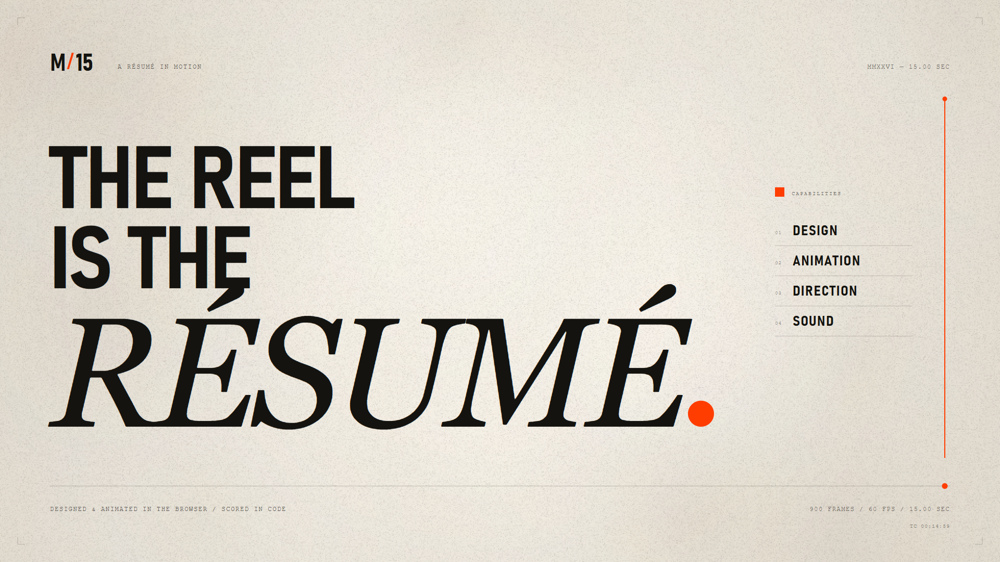

# M/15 — A Résumé in Motion

A 15-second, 1920×1080, 60 fps motion-graphics film. The film is the résumé: it argues for typographic control, rhythm, restraint, and systems thinking by demonstrating them rather than listing them.

**Final film:** [`out/m15-resume.mp4`](./out/m15-resume.mp4)



## The idea

A résumé is usually a static list of claims. A motion designer's résumé should behave like the work.

The film uses one line, one dot, and one accent colour to move through five short acts: a title, a composition study, a rhythm study, a systems study, and a signature. The visual language is warm paper, black ink, vermilion, DIN-like display type, a high-contrast serif, and typewriter microcopy. The line becomes a horizon, a baseline, a metronome arm, a progress rule; the dot becomes a period, a focal point, a metronome weight, a playhead, a system token.

There is no stock footage, no image asset, and no music sample. Every frame and every sound is generated from code.

## Timeline

| Time | Act | What happens |
|---|---|---|
| 0.00–0.78 | Cold open | A single red dot in black, pulsing once, then stretching into a horizon line. |
| 0.78–3.00 | 01 / Title | The horizon settles into a typographic baseline. “A RÉSUMÉ / IN MOTION.” reveals from masks. Red dot period. Ink curtain rises over the composition. |
| 3.00–6.00 | 02 / Composition | Paper becomes ink. “I ARRANGE.” and a giant ATTENTION assemble from ten moving vertical strips; a red focal disc enters from the right. Paper strips wipe the frame. |
| 6.00–9.00 | 03 / Time | Paper, a red-accented metronome, a live time ruler, and “I DESIGN / TIME.” The metronome swings at 80 BPM. |
| 9.00–12.00 | 04 / Systems | Ink. One component moves through seven states – block, orbit, input, modules, grid, signal, identity – while the copy shifts from “ONE IDEA.” to “MANY STATES.” A paper card rises. |
| 12.00–15.00 | 05 / Signature | Paper. “THE REEL / IS THE / RÉSUMÉ.” lands line by line; capabilities and production notes lock in. The final frame holds. |

## Design system

- **Palette:** paper `#efe9de`, ink `#14130f`, vermilion `#ff3d00`
- **Display:** Bahnschrift Condensed / Bahnschrift, tightly tracked
- **Editorial:** Georgia Italic
- **Microcopy:** Courier New, tracked wide
- **Grid:** 96 px side margins, 12 columns, 24 px gutters
- **Motion grammar:** mask reveals, print-registration ticks, hard cuts, paper wipes, one metronome swing, one component metamorphosis. No particle bursts, RGB splits, lens flares, neon glow, shockwave rings, or elastic bounce.

## Technical approach

- One HTML canvas, one `seek(t)` drawing function. Every visual is a pure function of time; there is no CSS animation, `Date.now()`, `setTimeout`, or cross-frame state.
- Pre-rendered paper tooth, fibre and grain textures use a seeded PRNG, so repeated frames are deterministic.
- `render.mjs` serves the project locally, opens four headless Chrome pages with Playwright, calls `window.seek(t)` for each frame, writes a PNG sequence, then muxes with FFmpeg.
- Audio is synthesized in `audio.py` with NumPy/SciPy at 80 BPM: five 4/4 bars, A minor to C major, with an additive pad, sub bass, kick, snare/clap, hi-hats, typewriter stamps, metronome clicks, paper rustles, whooshes, bells, and a convolution reverb. It is mastered to approximately −15 LUFS, −1 dBTP.

### Delivery specs

- 1920 × 1080, 60 fps, 900 frames, 15.000 s
- H.264 High, yuv420p, CRF 15, `+faststart`
- AAC 256 kbps, 48 kHz stereo
- Score: original, synthesized; no third-party samples

## Run it

Requirements: Node.js 20+, Chrome, FFmpeg, Python 3.10+, NumPy, SciPy. The typography uses Windows system fonts.

```powershell
npm install
python audio.py
node render.mjs --mode=stills
node render.mjs --mode=video --workers=4
```

Useful variants:

```powershell
# Inspect selected frames only
node render.mjs --mode=stills --times=0,0.9,2.2,4.5,7,10,12.4,14.95

# Render a range without encoding
node render.mjs --mode=video --from=0 --to=179 --workers=4 --no-encode

# Encode an existing PNG sequence with the existing score
node render.mjs --mode=encode
```

The output is written to `out/m15-resume.mp4`; the frame sequence lives in `frames/` and can be deleted after encoding.

## Delivered file

| Property | Value |
|---|---|
| File | `out/m15-resume.mp4` |
| Duration | 15.000 s |
| Picture | 1920 × 1080, 60 fps, 900 frames, H.264 High / yuv420p |
| Data rate | 14.55 Mbps (27,281,429 bytes) |
| Audio | AAC LC, 48 kHz stereo, 256 kbps |
| Loudness | −15.0 LUFS integrated, −0.9 dBTP |
| Colour | BT.709, SDR |

Also delivered:
- `out/poster.png` — the final 1920×1080 card
- `out/contact-sheet.png` — one frame per second across the film
- `out/score.wav` — the original 48 kHz score used in the mux

## Validation

- Key frames were checked at 0.4–14.95 s for text clipping, overlap, and composition.
- The title, ATTENTION, TIME, systems, and signature cards were each reviewed at full 1920×1080 resolution.
- `ffprobe` reports 15.000 s, 1920×1080, 60 fps, and 900 decoded video frames.
- The final H.264/AAC file decodes with `ffmpeg -v error -i out/m15-resume.mp4 -f null -` without errors.
- Loudness measured on the delivered MP4 is −15.0 LUFS with a −0.9 dBTP true peak.
- The first and last frames are intentionally different: the film opens on a black field with a red dot and closes on a held paper end card.
- No claims of client work, awards, or metrics appear in the film.

## Notes and limits

- The film is a self-initiated motion study, not a client case study. There are no invented clients, awards, metrics, or endorsements.
- The browser source relies on Windows system fonts. Re-rendering on another OS may substitute different typefaces; the delivered MP4 is the reference.
- Audio was mixed and measured numerically; final subjective listening should happen on the target playback system.
