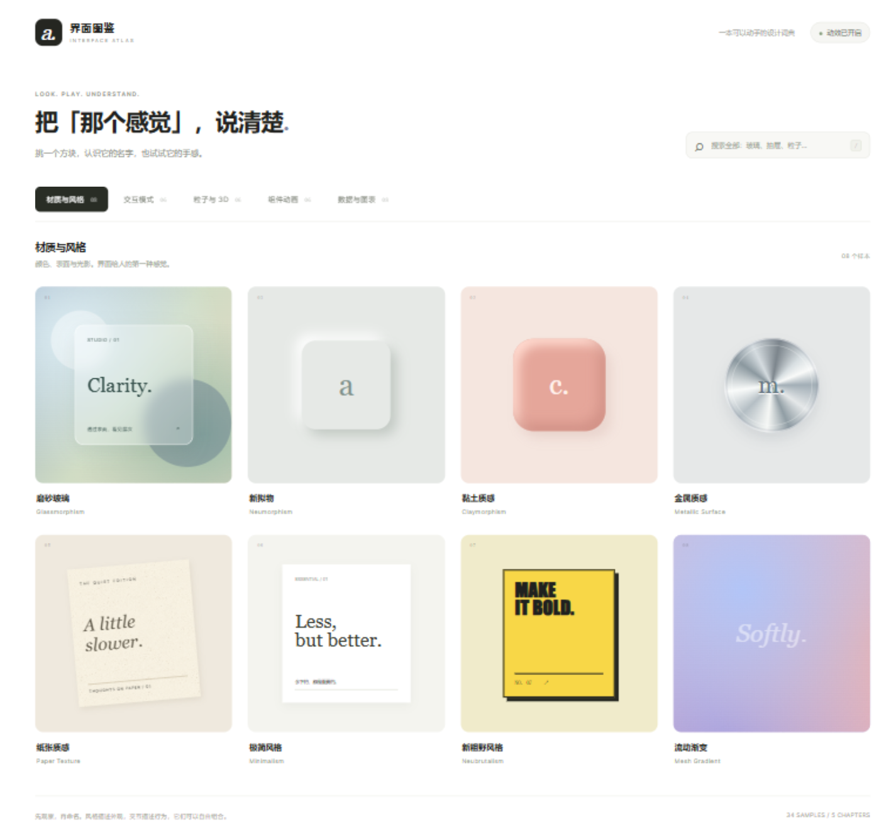

# 界面图鉴 · 2D 方块版

日期：2026-09-17。当前学习入口，替代继续开发 3D 收藏馆的方向。

本地预览：[打开界面图鉴](http://127.0.0.1:8768/)。本地服务运行时有效。源文件为 `index.html`、`styles.css`、`app.js`、`data.js`、`demos.js` 、`particles.js` 和 `pointer-demos.js`，没有框架或第三方运行时依赖。

## 使用

1. 在五个标签页中选择分类，浏览独立的方块样本。
2. 点击方块，查看中英文名称、特征、解释、观察提示和容易混淆的概念。
3. 在介绍框左侧操作示例：调整材质参数，打开抽屉，拖动粒子，切换动画，或对数据排序。
4. 编辑“这样告诉 AI”的描述后复制；也可以用上一项/下一项连续浏览。
5. 搜索覆盖全部分类。右上角开关可以暂停动效；初始状态遵循系统减少动态效果偏好。

| 分类 | 数量 | 条目 |
| --- | ---: | --- |
| 材质与风格 | 8 | 磨砂玻璃、新拟物、黏土、金属、纸张、极简、新粗野、流动渐变 |
| 交互模式 | 6 | 抽屉、模态弹窗、气泡卡片、文字提示、标签页、折叠面板 |
| 粒子与 3D | 6 | 粒子球、波浪、星系、点线网络、流场轨迹、轨道光环 |
| 组件动画 | 8 | 弹簧回弹、悬停按压、卡片翻转、依次入场、骨架屏、轻提示、视线跟随、磁吸交互 |
| 数据与图表 | 8 | 柱状图、折线图、环形图、散点图、热力图、表格、指标卡、状态图标 |

“交互模式”解释操作组织方式；“组件动画”解释变化过程与操作反馈。分类用于学习，不是互斥的行业标准。用户提到的数据表格/图标在本版同时覆盖图表与状态图标。

## 实现与边界

- CSS 材质直接作用在示例控件上；不是把整个页面截图当作界面。
- 粒子使用三维坐标和透视投影，在 Canvas 上绘制；不是实体 3D 建模或物理流体仿真。支持拖动观察、方向键转向、数量、速度和暂停。
- 数据均为教学示例，图表没有连接外部业务数据。
- 复制操作会请求浏览器剪贴板；失败时选中文本并提示手动复制。没有登录、云端收藏、后台服务或数据提交。
- 纸张的细纹理复用了此前 Image Gen 生成的本地石材素材，并以低透明度叠加，仅用于材质观察。
- 条目说明收录于 `data.js` 和 `pointer-demos.js`；增加条目时同时实现对应预览与示例。

## 验证记录

见 [浏览器检查记录](qa/README.md)。首版已检查 34 项打开、代表性交互、搜索、键盘焦点、桌面和手机布局；没有进行正式可用性研究或全平台兼容性认证。

## 本地复现

在本目录运行 `python -m http.server 8768 --bind 127.0.0.1`，访问上述地址。页面使用 ES modules，应通过 HTTP 打开。

## 教学与语义参考

2026-09-17 核对了以下官方资料：

- [W3C Modal Dialog](https://www.w3.org/WAI/ARIA/apg/patterns/dialog-modal/)：背景不可交互、焦点循环与关闭后焦点恢复。
- [W3C Tabs](https://www.w3.org/WAI/ARIA/apg/patterns/tabs/)：标签与内容面板、方向键导航。
- [MDN prefers-reduced-motion](https://developer.mozilla.org/en-US/docs/Web/CSS/Reference/At-rules/@media/prefers-reduced-motion)：系统减少动态效果偏好。

风格名称是交流标签，不具有统一严格定义；每项都用可见特征与具体需求描述补充。

视线跟随与磁吸的机制、坐标计算和使用边界，见 [指针交互原理](../../docs/pointer-interactions.md)。两项均是机制演示，不是设计质量范例。
